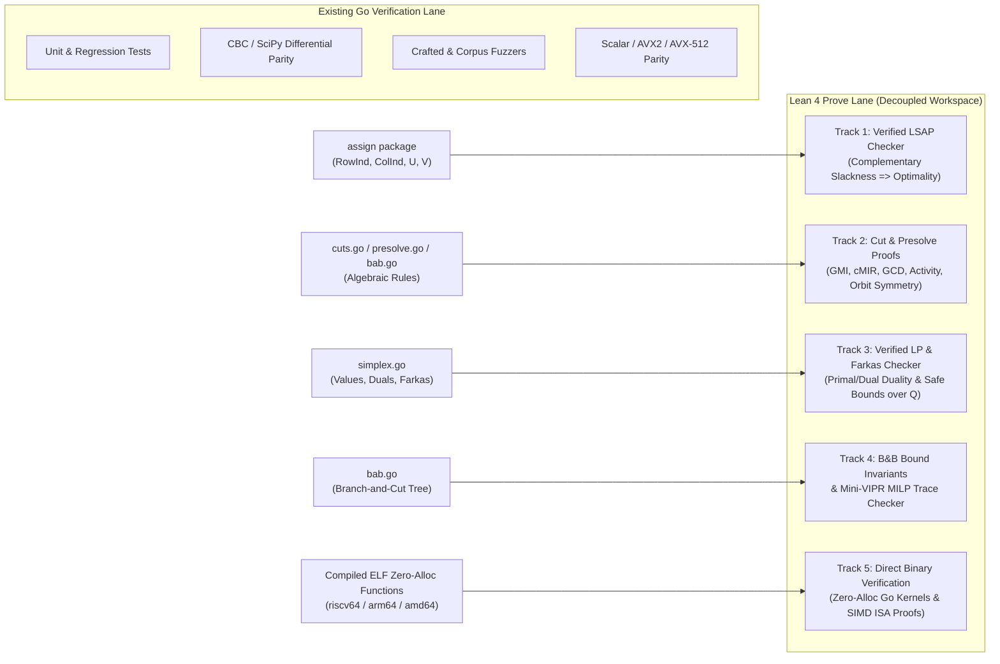

# Formal Verification Roadmap (Lean 4 Prove Lane)

This specification defines a staged Lean 4 verification lane for `goblin` that certifies solver outputs, proves the soundness of algebraic MILP rules, and scopes targeted binary-level verification of pure leaf functions without lifting the Go runtime. Full-program verification of the 64k-line Go solver, garbage-collected runtime, or floating-point Markowitz `LU` factorization ([`lu.go`](../lu.go)) remains out of scope.

---

## 1. Architectural Decision and Boundaries

The `goblin` solver already maintains a four-part empirical verification suite: unit and regression tests, differential parity against COIN-OR CBC and SciPy, targeted fuzzers (`fuzz_test.go`, `mad_fuzz_test.go`, `assign/fuzz_test.go`), and scalar-vs-SIMD parity tests. The Lean 4 Prove Lane closes three gaps that empirical testing cannot eliminate:

1. **Result soundness**: a machine-checked proof that a concrete primal/dual output produced by `goblin` or `goblin/assign` is globally optimal or infeasible, independent of bugs in the Go solver or SIMD kernels.
2. **Rule soundness**: a machine-checked proof that algebraic cuts, presolve tightenings, and branch-and-bound pruning rules preserve all feasible integer solutions.
3. **Compiled-binary leaf assurance (experimental)**: a machine-checked proof directly over compiled `riscv64`, `arm64`, or `amd64` machine instructions for small, allocation-free `goblin` helpers and SIMD kernel invariants, eliminating compiler and translation trust on those functions.



### Rejected Approaches

We explicitly reject three verification patterns for `goblin`:

- **Direct Go-to-Lean source lifting**: Tools such as Aeneas succeed on Rust because the borrow checker eliminates pointer aliasing and exposes pure functional semantics. Go lacks an ownership type system and a mature Lean source-extraction pipeline; hand-translating imperative Go into Lean creates an unverified translation gap.
- **Full-program binary verification across the Go GC and runtime**: No published work verifies Go's concurrent tri-color mark-and-sweep garbage collector (`runtime.mallocgc`, `runtime.gcWriteBarrier*`) or goroutine scheduler at the machine-code level. State-of-the-art verified GCs (CakeML in HOL4, CertiCoq via CompCert) verify bespoke, single-threaded copying or mark-and-sweep collectors built inside a proof assistant from scratch. Empirical disassembly (`go tool objdump`) of `goblin` confirms that allocating routines such as `verifyExactRationalFarkas` (2,759 instructions) invoke `runtime.makeslice`, `runtime.growslice`, `runtime.mallocgc*`, and `runtime.gcWriteBarrier2`/`3`, pulling the entire Go runtime into the proof. Binary verification in `goblin` therefore targets only **zero-allocation, GC-free paths** (Track 5), which cover far more than trivial helpers thanks to `goblin`'s pre-allocated `Workspace` architecture.
- **Floating-point proof of numerical linear algebra**: Proving IEEE-754 rounding bounds for Markowitz pivoting and Forrest-Tomlin `U` updates ([`lu.go`](../lu.go)) carries extreme proof cost for low defect yield. A posteriori certificate checking verifies solver outputs directly without trusting those internals.
- **Complementary Go-native verifiers (outside Lean)**: If source-level panic-freedom and slice-bounds proofs over allocating Go code are ever needed without Lean ISA models, **Gobra** (ETH Zurich, Viper/SMT) and **Goose/Perennial** (Rocq/Coq) are the established Go-native options. They target Go source rather than compiled binaries and do not replace Lean 4's mathematical certification libraries.

---

## 2. Industry Precedents and Anti-Translation-Gap Rules

The Prove Lane adopts patterns validated by production and research Lean 4 verification systems (2024 to 2026):

| Precedent | Domain | Architecture | Adopted Rule for `goblin` |
| :--- | :--- | :--- | :--- |
| **Google DeepMind AlphaProof Code (`google-deepmind/code-verification`)** | Production cryptographic library (`libsignal`, compiled AArch64 binaries) | Verified unmodified compiled AArch64 Linux machine code directly against open-source Lean 4 AArch64 semantics (`arm64-semantics/`, `ElfRunsTo`, ~6.5M lines of proofs covering ~140k instructions) | Proves that Lean 4 binary verification works on stock compiled ELF code; open `arm64-semantics/` is directly reusable for **Track 5** on `GOARCH=arm64` zero-alloc Go routines |
| **Anthropic + Theorem (123 OSS-Fuzz libraries)** | Production C/C++ binaries (static single-threaded RISC-V `musl` ELF) | Verified 239 fuzz entry points in Rocq (~180M lines) for bounded crash-freedom (< 64 MB inputs) using Theorem's Linux Process Semantics | Highlights the domain contrast: C/C++ needs crash-freedom proofs, whereas Go already enforces memory safety at runtime; `goblin`'s primary risk is mathematical/optimality soundness (Tracks 1 to 3) |
| **Anthropic FlashProve** (*Provable Inference for LLMs*) | Cryptographic inference verification | Fast C++ execution engine paired with a Lean-verified checker and short, human-auditable top-level theorems | Keep top-level optimality and soundness theorem statements concise and auditable; keep execution speed in Go |
| **`leanprover/lp-verify`, LeanSAT (`bv_decide`), & LeanVIPR** | LP, SAT/Bitvectors, and MILP certification | Untrusted external solver emits a mathematical certificate (dual multipliers, Farkas ray, LRAT, or VIPR trace); pure-Lean checker validates it inside the kernel | Prefer certificate checking wherever `goblin` already computes witnesses (`U`/`V` in `assign`, `Duals`/`Farkas` in `simplex.go`) |
| **AWS Cedar (`cedar-spec`) & Belay (SQLite)** | Cloud authorization (Rust) and SQLite queries/migrations | Small executable Lean 4 semantic specification + formal proofs + high-volume differential testing against the shipping engine | Pair every rule-level Lean model with automated Go-vs-Lean differential testing so implementations cannot drift |
| **`lean-zip` (zlib), `nasa-jpl/L4YAML`, & `conao3/lean-py`** | Compression, YAML 1.2.2 parsing, Python-Lean bridges | Verified Lean 4 kernel compiled natively and invoked through thin host adapters or CLI boundaries | Compile Lean checkers to standalone executables via `lake build`; keep `go test ./...` free of Lean toolchain dependencies |
| **Certora (`zlib` `inflate_table`) & `zksecurity/leanPython`** | Legacy C and Python 3.12 in Lean | Targeted C-to-Lean lifting and unverified Lean re-implementations | Do not confuse writing Lean code with formal verification; every Prove Lane file must prove its target invariant with zero `sorry` |

### Three Non-Negotiable Integrity Rules

1. **Zero translation gap via certificates or binary proofs**: Whenever `goblin` can emit a witness, verify the output of the actual Go binary inside a compiled, kernel-verified Lean checker (Tracks 1, 3, and 4). Where a witness is unavailable on a small, pure leaf routine, verify the compiled machine code directly against a formal ISA model (Track 5).
2. **Differential closure for rule specs**: Whenever a theorem covers an internal algorithm (such as GCD infeasibility or cMIR generation in Track 2), write the Lean spec as an executable function and run differential tests against the Go function over randomized inputs.
3. **Axiom audit**: Every proven theorem must pass `#print axioms` showing only standard Lean axioms (`propext`, `Quot.sound`, `Classical.choice`) and zero `sorryAx` or custom axioms.

---

## 3. Staged Prove Lane Roadmap

All Lean 4 artifacts live in an isolated Lake workspace (`formal/`) so default Go builds, `CGO_ENABLED=0` binaries, and `doc_sync_test.go` telemetry fingerprints remain unaffected.

### Phase 0: Toolchain and Workspace Scaffolding

- Pin a stable Lean 4 release in `formal/lean-toolchain` via `elan`.
- Create `formal/lakefile.toml` with zero external dependencies for Tracks 1 and 2A (fast builds without downloading Mathlib). Add `Mathlib` or `leanprover/lp-verify` only when required by real-valued cut proofs or Track 3.

### Track 1: Verified LSAP Optimality Checker (`goblin/assign`)

- **Target surface**: `Result{RowInd, ColInd, Objective, U, V}` in [`assign/assign.go`](../assign/assign.go) and dual invariants in [`assign/solver.go`](../assign/solver.go) (both square $m = n$ and rectangular $m < n$ with $v_j = 0$ on unassigned columns).
- **Executable checker**: `checkLSAP (C : Matrix m n Rat) (p : Fin m -> Fin n) (u : Fin m -> Rat) (v : Fin n -> Rat) : Bool` verifying injectivity of `p`, dual feasibility $u_i + v_j \le C_{ij}$, unassigned dual condition $v_j = 0$ for $j \notin \text{range}(p)$ when $m < n$, and complementary slackness $u_i + v_{p(i)} = C_{i, p(i)}$.
- **Top-level theorem**: `checkLSAP_sound` proving that if `checkLSAP C p u v = true`, then $\sum_i C_{i, p(i)} \le \sum_i C_{i, q(i)}$ for every injective assignment $q : \text{Fin } m \to \text{Fin } n$.
- **Integration**: Compile `lake exe lsap-check` and run an opt-in Go test that exports real `goblin/assign` solutions (both scalar and SIMD) and verifies acceptance on valid outputs and rejection on perturbed negative controls.

### Track 2: Soundness Proofs for MILP Cuts, Presolve, and B&B Rules

Prove that `goblin`'s exact algebraic transformations never cut off a feasible integer solution:

1. **Integer Equality GCD Infeasibility** ([`bab.go`](../bab.go), `hasInfeasibleIntegerEqRow`): Prove that if $g \mid a_j$ for all columns $j$ and $\lceil \text{lo} / g \rceil \cdot g > \text{hi}$, no integer vector $x \in \mathbb{Z}^n$ satisfies $\text{lo} \le \sum_j a_j x_j \le \text{hi}$. Cross-check `divCeilInt64` edge cases on negative dividends via differential testing.
2. **Presolve Activity Tightening and Coefficient Strengthening** ([`presolve.go`](../presolve.go), `evalRowActivitySummary`, `residualQuotient`, `presolveCanSkipTerm`): Prove implied bound validity, integer bound rounding, and binary coefficient strengthening ($\delta = b_i - (\overline{\alpha}_i - a_{ij})$ on $\le$ rows).
3. **Cutting-Plane Soundness** ([`cuts.go`](../cuts.go)):
   - **GMI cuts** (`separateGMICutsEx`): prove the mixed-integer tableau inequality holds for all feasible mixed-integer points with $\tilde{x}_j \ge 0$.
   - **Single-row cMIR and row aggregation** (`separateCMIRFromSparseRow`, `mirUseLower`, `rowLegalMuSign`): prove complementation, MIR function validity, and aggregation multiplier sign legality.
   - **VUB disaggregation** (`separateFlowAndVUBCuts`): prove $\sum_k a_k x_k - C y \le 0$ with $x_k \ge 0$ and $y \in \{0, 1\}$ implies $x_k \le \min(u_k, C / a_k) y$.
4. **Orbital Symmetry Breaking** ([`presolve.go`](../presolve.go), `applyOrbitSymmetryBreaking`, `verifyOrbitSymmetry`): Prove that fixing an orbit representative under a verified column automorphism preserves the optimal objective value.

### Track 3: Verified LP Optimality and Farkas Infeasibility Checker (`simplex.go`)

- **Target surface**: `Result.Values`, `Result.Duals`, and `Result.ReducedCosts` in [`solve.go`](../solve.go), alongside `verifyUnscaledFarkas` and `verifyExactRationalFarkas` in [`simplex.go`](../simplex.go).
- **Dual certification**: Reuse `leanprover/lp-verify` or implement a standalone `Rat` checker proving weak duality (primal feasibility + dual feasibility + zero duality gap implies global optimality) and Farkas infeasibility (dual cone ray yielding $0 \ge 1$ implies no primal solution exists).
- **Safe floating-point dual bounds**: Formalize Neumaier-Shcherbina safe dual bounding over `Rat` (converting `float64` duals as exact dyadic rationals $m \cdot 2^e$ and bounding dual residuals against finite variable bounds $[l_j, u_j]$) so `goblin` can obtain machine-checked lower bounds even from inexact floating-point simplex solutions.

### Track 4: Branch-and-Bound Bound Monotonicity and Mini-VIPR Traces (`bab.go`)

1. **Global Bound State Machine**: Formalize the abstract `babEngine` state (`openQueue`, incumbent cutoff, `prunedMinBound`, unresolved node bounds, `isGapClosed`) and prove that `BestBound` remains a valid lower bound on the global MILP optimum across branching, fathoming, reduced-cost fixing, and budget exits (`StatusTimeLimit`, `StatusNodeLimit`, `StatusIterationLimit`).
2. **Mini-VIPR Trace Verification**: Emit an opt-in rational proof log from single-threaded `goblin` MILP solves (root LP bound, valid cuts, branching splits, and leaf Farkas/dual bounds) and verify tree closure inside Lean 4.

### Track 5: Direct Binary Verification of Zero-Allocation Go Kernels and SIMD Functions (Experimental)

Inspired by Google DeepMind's open-source `google-deepmind/code-verification` (`arm64-semantics/` and `ElfRunsTo` in Lean 4) and `opencompl/sail-riscv-lean` (`BasisResearch/ship-your-interpreter`), this track verifies **actual stock-compiled Go ELF machine code** (`GOARCH=arm64`, `GOARCH=riscv64`, or `GOARCH=amd64`) without requiring a formal model of Go's concurrent GC:

- **Why `goblin` reaches further than typical Go code**: Because `goblin` pre-allocates working arrays inside `Workspace` and `CompiledProblem`, empirical `go tool objdump` inspection shows that entire core solver routines compile with **zero `runtime.mallocgc` and zero `runtime.gcWriteBarrier` calls**:
  - `hasInfeasibleIntegerEqRow` ([`bab.go`](../bab.go)): 281 instructions, zero heap allocations, zero GC write barriers.
  - `augmentRowScalar` ([`assign/solver.go`](../assign/solver.go)): 351 instructions, zero heap allocations, zero GC write barriers (only `runtime.selectnbrecv` when context cancellation is active).
- **Handling Go's non-GC runtime stubs cleanly**:
  - `runtime.morestack_noctxt` (stack-growth prologue): discharged by a single stack-headroom precondition (`SP - frameSize >= g.stackguard0`), avoiding any stack-copying runtime model.
  - `runtime.panicBounds` and `runtime.panicdivide`: proven **unreachable** under valid `CompiledProblem` / `Workspace` slice invariants, which simultaneously proves panic-freedom of the compiled binary.
- **Concrete `goblin` progression inside Track 5**:
  1. **Tier 5A (Pure integer helpers)**: `gcdInt64`, `divCeilInt64`, `presolveSplitmix64`, and `canonicalFloatBits`, compiled to `riscv64` or `arm64`, proving exact bit-level equivalence with Lean's `Int`/`UInt64` specification.
  2. **Tier 5B (Zero-alloc solver routines)**: `hasInfeasibleIntegerEqRow` and `augmentRowScalar` (with nil-channel fast path), compiled to `arm64` (`google-deepmind/code-verification` `arm64-semantics`) or `riscv64` (`opencompl/riscv-lean`), proving panic-freedom and functional postconditions directly on the emitted Go binary.
  3. **Tier 5C (SIMD ABI and ISA safety invariants)**: formalizing the disassembly and CFG audit checks in [`cmd/goblin-optcheck/main.go`](../cmd/goblin-optcheck/main.go) over the compiled `amd64` control-flow graph of `go:noinline` AVX2/AVX-512 kernels in [`internal/simd/`](../internal/simd/) (proving `VZEROUPPER` on every exit path and zero reachable EVEX instructions on non-AVX-512 paths).
- **Cost boundary**: Tracks 1 to 3 deliver stronger solver-wide mathematical guarantees (optimality and infeasibility of the entire 64k-line engine) in hundreds of lines of Lean, whereas Track 5 requires external ISA semantics libraries and larger proof effort per function. Track 5 therefore remains an experimental lane executed after Tracks 1 and 2 establish the Lean workflow.

---

## 4. Verification Protocol

Execute these checks for every Prove Lane milestone before merging:

```bash
# 1. Build and kernel-check all Lean proofs (must exit 0 with zero sorry warnings)
cd formal && lake build
# Expected output: Build completed successfully.

# 2. Run verified checker against exported goblin test fixtures (positive and negative controls)
cd formal && lake exe lsap-check ../testdata/formal/lsap_sample.json
# Expected output: VERIFIED

# 3. Confirm zero regressions in the existing Go solver and documentation gates
cd goblin && go test ./...
# Expected output: ok github.com/paulourio/goblin ...
```
