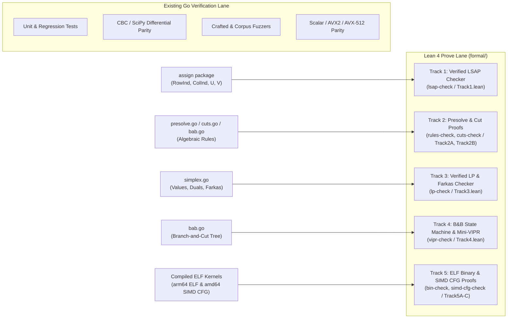

# Formal Verification Architecture (Lean 4 Prove Lane)

The `goblin` Lean 4 Prove Lane certifies solver outputs, proves the soundness of algebraic MILP rules, and verifies compiled binary invariants for pure leaf helpers and SIMD kernels without lifting the Go runtime. Full-program verification of the 64k-line Go solver, garbage-collected runtime, or floating-point Markowitz `LU` factorization ([`lu.go`](../lu.go)) remains out of scope. All proofs and standalone verifiers live in an isolated Lake workspace ([`formal/`](../formal/lakefile.toml)) pinned to Lean `v4.36.0` with zero external package dependencies.

---

## 1. Architectural Decision and Boundaries

The `goblin` solver maintains a four-part empirical verification suite: unit and regression tests, differential parity against COIN-OR CBC and SciPy, targeted fuzzers (`fuzz_test.go`, `mad_fuzz_test.go`, `assign/fuzz_test.go`), and scalar-vs-SIMD parity tests. The Lean 4 Prove Lane closes three gaps that empirical testing cannot eliminate:

1. **Result soundness**: machine-checked proofs show that concrete primal/dual outputs from `goblin` or `goblin/assign` are globally optimal or infeasible, independent of bugs in the Go solver or SIMD kernels.
2. **Rule soundness**: machine-checked proofs show that algebraic cuts, presolve tightenings, symmetry breaking, and branch-and-bound pruning rules preserve all feasible integer solutions.
3. **Compiled-binary leaf assurance**: machine-checked proofs directly over stock compiled `arm64` ELF instructions and disassembled `amd64` SIMD control-flow graphs verify pure leaf equivalence, zero heap allocation, panic-bounds unreachability, and `VZEROUPPER`/EVEX ABI invariants.



### Rejected Approaches

We explicitly reject three verification patterns for `goblin`:

- **Direct Go-to-Lean source lifting**: Tools such as Aeneas succeed on Rust because the borrow checker eliminates pointer aliasing and exposes pure functional semantics. Go lacks an ownership type system and a mature Lean source-extraction pipeline; hand-translating imperative Go into Lean creates an unverified translation gap.
- **Full-program binary verification across the Go GC and runtime**: No published work verifies Go's concurrent tri-color mark-and-sweep garbage collector (`runtime.mallocgc`, `runtime.gcWriteBarrier*`) or goroutine scheduler at the machine-code level. State-of-the-art verified GCs (CakeML in HOL4, CertiCoq via CompCert) verify bespoke, single-threaded copying or mark-and-sweep collectors built inside a proof assistant from scratch. Empirical disassembly (`go tool objdump`) of `goblin` confirms that allocating routines such as `verifyExactRationalFarkas` (2,759 instructions) invoke `runtime.makeslice`, `runtime.growslice`, `runtime.mallocgc*`, and `runtime.gcWriteBarrier2`/`3`, pulling the entire Go runtime into the proof. Binary verification in `goblin` therefore targets only **zero-allocation, GC-free paths** (Track 5), which cover far more than trivial helpers thanks to `goblin`'s pre-allocated `Workspace` architecture.
- **Floating-point proof of numerical linear algebra**: Proving IEEE-754 rounding bounds for Markowitz pivoting and Forrest-Tomlin `U` updates ([`lu.go`](../lu.go)) carries extreme proof cost for low defect yield. A posteriori certificate checking verifies solver outputs directly without trusting those internals.
- **Complementary Go-native verifiers (outside Lean)**: If source-level panic-freedom and slice-bounds proofs over allocating Go code are ever needed without Lean ISA models, **Gobra** (ETH Zurich, Viper/SMT) and **Goose/Perennial** (Rocq/Coq) are the established Go-native options. They target Go source rather than compiled binaries and do not replace Lean 4's mathematical certification libraries.

---

## 2. Industry Precedents and Anti-Translation-Gap Rules

The Prove Lane adopts patterns validated by production and research Lean 4 verification systems (2024 to 2026):

| Precedent | Domain | Architecture | Adopted Rule for `goblin` |
| :--- | :--- | :--- | :--- |
| **Google DeepMind AlphaProof Code (`google-deepmind/code-verification`)** | Production cryptographic library (`libsignal`, compiled AArch64 binaries) | Verified unmodified compiled AArch64 Linux machine code directly against open-source Lean 4 AArch64 semantics (`arm64-semantics/`, `ElfRunsTo`, ~6.5M lines of proofs covering ~140k instructions) | Proves that Lean 4 binary verification works on stock compiled ELF code; Track 5 models AArch64 instruction semantics directly in `Track5A.lean` and `Track5B.lean` |
| **Anthropic + Theorem (123 OSS-Fuzz libraries)** | Production C/C++ binaries (static single-threaded RISC-V `musl` ELF) | Verified 239 fuzz entry points in Rocq (~180M lines) for bounded crash-freedom (< 64 MB inputs) using Theorem's Linux Process Semantics | Highlights the domain contrast: C/C++ needs crash-freedom proofs, whereas Go already enforces memory safety at runtime; `goblin`'s primary risk is mathematical/optimality soundness (Tracks 1 to 3) |
| **Anthropic FlashProve** (*Provable Inference for LLMs*) | Cryptographic inference verification | Fast C++ execution engine paired with a Lean-verified checker and short, human-auditable top-level theorems | Keep top-level optimality and soundness theorem statements concise and auditable; keep execution speed in Go |
| **`leanprover/lp-verify`, LeanSAT (`bv_decide`), & LeanVIPR** | LP, SAT/Bitvectors, and MILP certification | Untrusted external solver emits a mathematical certificate (dual multipliers, Farkas ray, LRAT, or VIPR trace); pure-Lean checker validates it inside the kernel | Prefer certificate checking wherever `goblin` already computes witnesses (`U`/`V` in `assign`, `Duals`/`Farkas` in `simplex.go`) |
| **AWS Cedar (`cedar-spec`) & Belay (SQLite)** | Cloud authorization (Rust) and SQLite queries/migrations | Small executable Lean 4 semantic specification + formal proofs + high-volume differential testing against the shipping engine | Pair every rule-level Lean model with automated Go-vs-Lean differential testing so implementations cannot drift |
| **`lean-zip` (zlib), `nasa-jpl/L4YAML`, & `conao3/lean-py`** | Compression, YAML 1.2.2 parsing, Python-Lean bridges | Verified Lean 4 kernel compiled natively and invoked through thin host adapters or CLI boundaries | Compile Lean checkers to standalone executables via `lake build`; keep `go test ./...` free of Lean toolchain dependencies |
| **Certora (`zlib` `inflate_table`) & `zksecurity/leanPython`** | Legacy C and Python 3.12 in Lean | Targeted C-to-Lean lifting and unverified Lean re-implementations | Do not confuse writing Lean code with formal verification; every Prove Lane file proves its target invariant with zero `sorry` |

### Three Non-Negotiable Integrity Rules

1. **Zero translation gap via certificates or binary proofs**: Whenever `goblin` can emit a witness, the standalone Lean executable checks the output of the actual Go binary inside a kernel-verified checker (Tracks 1, 3, and 4). Where a witness is unavailable on a small, pure leaf routine or zero-alloc kernel, Track 5 verifies the compiled machine code directly against a formal ISA or CFG model.
2. **Differential closure for rule specs**: Whenever a theorem covers an internal algorithm (such as GCD infeasibility, presolve tightening, or cMIR cut generation in Track 2), the Lean specification runs as an executable function under `GOBLIN_FORMAL=1` differential Go tests against live `goblin` routines.
3. **Axiom audit**: Every proven theorem passes `#print axioms` with zero `sorryAx`, zero `Lean.trustCompiler`, and zero custom axioms; [`AxiomAudit.lean`](../formal/GoblinFormal/AxiomAudit.lean) enforces `#guard_msgs in #print axioms` locks across all top-level theorems on every `lake build`.

---

## 3. Implemented Prove Lane Architecture

All Lean 4 artifacts live in the isolated Lake workspace ([`formal/`](../formal/GoblinFormal.lean)) so default Go builds, `CGO_ENABLED=0` binaries, and [`doc_sync_test.go`](../doc_sync_test.go) telemetry fingerprints remain unaffected. All formal Go integration tests reside strictly in `*_test.go` files gated by `GOBLIN_FORMAL=1`.

### Workspace Foundation and Common Library

- **Toolchain & Lake Configuration**: [`formal/lean-toolchain`](../formal/lean-toolchain) pins `leanprover/lean4:v4.36.0`. [`formal/lakefile.toml`](../formal/lakefile.toml) declares zero external Lake dependencies, builds the `GoblinFormal` library, and exposes seven standalone CLI executables.
- **Common Arithmetic & Float64 Conversion** ([`Common/Basic.lean`](../formal/GoblinFormal/Common/Basic.lean)): Defines `finSum` over `Rat` and `intFinSum` over `Int` with proven linearity, injection-sum, and divisibility theorems (`finSum_inj_le`, `finSum_inj_eq`, `intFinSum_dvd`). Implements exact IEEE-754 binary64 bit-pattern conversion `float64BitsToRat` to dyadic `Rat` with `float64BitsToRat_isNone_iff` (rejecting Inf/NaN) and sign lemmas.
- **Pure `Init` JSON Parser** ([`Common/Json.lean`](../formal/GoblinFormal/Common/Json.lean)): Provides a total recursive-descent parser (`JsonVal`, `parseJson`) without importing the `Lean` compiler package, plus exact rational extractors (`asRat`, `asUInt64`, `getField`) supporting `{"num", "den"}` objects, `"num/den"` strings, and decimal numbers.

### Track 1: Verified LSAP Optimality Checker (`goblin/assign`)

- **Target surface**: `Result{RowInd, ColInd, Objective, U, V}` in [`assign/assign.go`](../assign/assign.go) and dual invariants in [`assign/solver.go`](../assign/solver.go) for both square ($m = n$) and rectangular ($m < n$ and $m > n$ via transposition) matrices.
- **Executable checker** ([`Track1.lean`](../formal/GoblinFormal/Track1.lean)): `checkLSAP` validates assignment injectivity, dual feasibility ($u_i + v_j \le C_{ij}$), rectangular dual invariants ($v_j \le 0$ and $v_j = 0$ on unassigned columns when $m < n$), and complementary slackness ($u_i + v_{p(i)} = C_{i, p(i)}$). The safe checker `checkLSAPSafe` computes `safeLowerBound` from `uSafe` when floating-point duals carry non-zero slack within tolerance `tol`.
- **Top-level theorems**: `checkLSAP_sound` and `checkLSAP_sound_max` prove global optimality over all injective assignments $q : \text{Fin } m \to \text{Fin } n$; `checkLSAPSafe_sound` and `checkLSAPSafe_sound_max` prove dual lower-bound and gap soundness.
- **CLI & Tests**: [`lsap-check`](../formal/Apps/LsapCheck.lean) verifies fixtures ([`lsap_sample.json`](../testdata/formal/lsap_sample.json), [`lsap_negative.json`](../testdata/formal/lsap_negative.json)) and live scalar/SIMD solutions in [`assign/formal_lsap_test.go`](../assign/formal_lsap_test.go) (`TestFormalLSAPVerification`).

### Track 2: Soundness Proofs for MILP Presolve, Symmetry, and Cuts

- **Track 2A (Presolve & Symmetry)** ([`Track2A.lean`](../formal/GoblinFormal/Track2A.lean), [`rules-check`](../formal/Apps/RulesCheck.lean)):
  1. **GCD Equality Infeasibility & `divCeil`** ([`bab.go`](../bab.go), `hasInfeasibleIntegerEqRow`, `divCeilInt64`): `divCeilSpec_spec` proves exact ceiling division across negative dividends; `gcd_row_infeasible_sound`, `gcd_row_infeasible_tol_sound`, and `hasInfeasibleIntEqSpec_sound` prove no integer vector satisfies $\text{lo} \le \sum_j a_j x_j \le \text{hi}$ when $g \mid a_j$ and $\lceil \text{lo} / g \rceil \cdot g > \text{hi}$.
  2. **Activity Tightening & Skipping** ([`presolve.go`](../presolve.go), `evalRowActivitySummary`, `residualQuotient`, `presolveCanSkipTerm`): `activity_implied_upper_sound` and `activity_implied_lower_sound` prove implied variable bounds; `presolveCanSkipTerm_sound` and `presolveCanSkipTerm_lower_sound` prove skip safety.
  3. **Binary Coefficient Strengthening** ([`presolve.go`](../presolve.go)): `binary_strengthen_pos_iff`, `binary_strengthen_pos_outward_sound`, and `binary_strengthen_neg_iff` prove equivalence and outward rounding soundness for binary coefficient tightening.
  4. **Orbital Symmetry Breaking** ([`presolve.go`](../presolve.go), `applyOrbitSymmetryBreaking`, `verifyOrbitSymmetry`): `orbit_automorphism_preserves_opt` and `monotone_orbit_order_sound` prove that ordering variables under a verified involution automorphism preserves optimal MILP objective values.
- **Track 2B (Cutting-Plane Soundness)** ([`Track2B.lean`](../formal/GoblinFormal/Track2B.lean), [`cuts-check`](../formal/Apps/CutsCheck.lean)):
  1. **GMI Tableau Cuts** ([`cuts.go`](../cuts.go), `separateGMICutsEx`): `gmi_cut_sound` and `gmi_weaken_upward_sound` prove validity for all feasible mixed-integer solutions with non-negative non-basic slacks.
  2. **Row Aggregation & cMIR Cuts** ([`cuts.go`](../cuts.go), `separateCMIRFromSparseRow`, `mirUseLower`, `rowLegalMuSign`): `row_agg_legal_sound`, `row_agg_sum_sound`, and `row_agg_error_bound_sound` prove multiplier sign legality and aggregation error bounds; `mir_fundamental_ineq`, `mir_cut_sound`, `cmir_safe_rounded_sound`, and `cmir_complement_sound` prove complementation, MIR cut validity, and outward safe rounding.
  3. **VUB Disaggregation & Cut Cleanup** ([`cuts.go`](../cuts.go), `separateFlowAndVUBCuts`): `vub_disagg_sound`, `vub_disagg_opt_sound`, and `cut_drop_scale_sound` prove disaggregation validity and coefficient dropping/scaling soundness.
- **Differential tests**: [`formal_track2a_test.go`](../formal_track2a_test.go) (`TestFormalTrack2A`) and [`formal_track2b_test.go`](../formal_track2b_test.go) (`TestFormalTrack2B`) cross-check Go routines against `rules-check` and `cuts-check` across positive and adversarial inputs.

### Track 3: Verified LP Optimality and Farkas Infeasibility Checker (`simplex.go`)

- **Target surface**: `Result.Values`, `Result.Duals`, and `Result.ReducedCosts` in [`solve.go`](../solve.go), alongside `verifyUnscaledFarkas` and `verifyExactRationalFarkas` in [`simplex.go`](../simplex.go).
- **Executable checker** ([`Track3.lean`](../formal/GoblinFormal/Track3.lean), [`lp-check`](../formal/Apps/LpCheck.lean)): Supports three modes (`optimal`, `safe-bound`, and `farkas`), parsing either exact rational strings or raw IEEE-754 `float64` bit patterns converted via `float64BitsToRat`.
- **Top-level theorems**: `checkPrimalFeasible_sound`, `safeDualBound_sound` (Neumaier-Shcherbina dual lower bound over `Rat`), `checkLPOptimal_sound` (zero-gap global LP optimality), and `checkFarkas_sound` (Farkas infeasibility).
- **Fixtures & Tests**: Verified on [`lp_optimal_sample.json`](../testdata/formal/lp_optimal_sample.json), [`lp_farkas_sample.json`](../testdata/formal/lp_farkas_sample.json), Netlib/boxed LP instances, and negative controls in [`formal_track3_test.go`](../formal_track3_test.go) (`TestFormalTrack3`).

### Track 4: Branch-and-Bound Bound Monotonicity and Mini-VIPR Traces (`bab.go`)

- **Global Bound State Machine** ([`Track4.lean`](../formal/GoblinFormal/Track4.lean)): Formalizes `BabState` (`openQueue`, `plungeNode`, `bestObjMin`, `prunedMinBound`, `unsolvedMinBound`, `isGapClosedSpec`) and proves invariant preservation (`ValidBabState`), global bound soundness (`bestBound_global_valid`, `infeasible_when_globalBound_none`), reduced-cost fixing (`rc_fixing_sound`, `dual_rc_bound_valid`, `stepReducedCostFix_valid`), budget abort safety (`stepBudgetAbort_valid`), and optimality upon gap closure (`stepGapClosed_optimal`, `stepGapClosed_exact_optimal`) across all transition steps (`stepRoot_valid`, `stepSelectOpen_valid`, `stepTightenLowerBound_valid`, `stepFathomInfeas_valid`, `stepFathomBound_valid`, `stepBranchInt_valid`, `stepIncumbent_valid`).
- **Mini-VIPR Trace Verifier** ([`Track4.lean`](../formal/GoblinFormal/Track4.lean), [`vipr-check`](../formal/Apps/ViprCheck.lean)): Verifies rational MILP derivation logs (`lincomb`, `roundUp`, `roundDown`, `assume`, `farkas`, `safeDual`, `dualBound`, `branch`) with strict assumption scoping (`checkMiniVIPR_sound`, `checkMiniVIPR_infeasible_sound`, `checkMiniVIPR_optimal_sound`).
- **Fixtures & Tests**: Verified on [`vipr_sample.json`](../testdata/formal/vipr_sample.json), corpus/multi-node MIPs, CG rounding infeasibility traces, and negative controls in [`formal_track4_test.go`](../formal_track4_test.go) (`TestFormalTrack4`).

### Track 5: Direct Binary Verification of Zero-Alloc Go Kernels and SIMD CFGs

- **Tier 5A (ARM64 Pure Leaf Equivalence)** ([`Track5A.lean`](../formal/GoblinFormal/Track5A.lean)): Implements a stock `GOARCH=arm64` ELF instruction decoder and operational semantics (`Arm64State`, `runArm64`). Proves bit-exact register/memory equivalence for four compiled Go 1.27 leaf helpers (`splitmix64_arm64_equiv`, `canonicalFloatBitsInlined_arm64_equiv`, `canonicalFloatBits_arm64_equiv`, `divCeilInt64_arm64_equiv`, `gcdInt64_arm64_equiv`).
- **Tier 5B (Zero-Alloc Solver Kernels)** ([`Track5B.lean`](../formal/GoblinFormal/Track5B.lean), [`bin-check`](../formal/Apps/BinCheck.lean)): Verifies five compiled Go 1.27 `arm64` solver routines (`hasInfeasibleIntegerEqRow`, `assign.augmentRowScalar`, `internal/simd.InitReducedRow64`, `assign.refillQueueIndirectScalar`, `assign.relaxRowIndirectScalar`). Proves zero heap allocation/GC write barriers (`checkZeroGC_run_sound`), stack-headroom soundness (`checkStackGuard_sound`), `runtime.panicBounds` unreachability (`checkPanicBoundsReachability_run_safe`), ELF safety (`hasInfeasibleIntegerEqRow_elf_safe`, `augmentRowScalar_elf_safe`, `augmentRowScalar_done_nil_no_selectnbrecv`), and concrete overlay executions (`hasInfeasibleIntegerEqRow_infeasible_gcd_exec`, `hasInfeasibleIntegerEqRow_feasible_gcd_exec`, `augmentRowScalar_concrete_exec`).
- **Tier 5C (amd64 SIMD ISA and CFG Safety)** ([`Track5C.lean`](../formal/GoblinFormal/Track5C.lean), [`simd-cfg-check`](../formal/Apps/SimdCfgCheck.lean)): Mirrors [`cmd/goblin-optcheck/main.go`](../cmd/goblin-optcheck/main.go) vector disassembly checks over inductive CFG operational semantics. The soundness theorem `checkVectorCFG_sound` proves that every reachable legacy SSE transition, `RET`, `CALL`, and external tail jump starts with clean upper YMM/ZMM bits (`VZEROUPPER`), and that non-AVX-512 functions contain zero reachable EVEX instructions.
- **ELF & CFG Differential Tests**: [`formal_track5_test.go`](../formal_track5_test.go) compiles live `CGO_ENABLED=0 GOOS=linux GOARCH=arm64` binaries (`TestFormalTrack5_BinCheckELF`) and disassembles live `amd64` binaries (`TestFormalTrack5_SimdCfgCheck`), validating all shipping kernels plus adversarial negative controls (`Neg_InjectedMallocgc`, `Neg_UnguardedPanicBounds`, `Neg_CorruptedImmediate`, `Neg_DirtyRet`, `Neg_DirtyCall`, `Neg_LegacySSEWhileDirty`, `Neg_UnguardedEVEX`).

### Summary Matrix of Modules, Executables, and Theorems

| Component | Module / App | Key Top-Level Theorems | Go Test Harness |
| :--- | :--- | :--- | :--- |
| **Common** | [`Common/Basic.lean`](../formal/GoblinFormal/Common/Basic.lean), [`Common/Json.lean`](../formal/GoblinFormal/Common/Json.lean) | `finSum_inj_le`, `finSum_inj_eq`, `intFinSum_dvd`, `float64BitsToRat_isNone_iff` | [`formal_common_test.go`](../formal_common_test.go), [`assign/formal_helper_test.go`](../assign/formal_helper_test.go) |
| **Track 1 (LSAP)** | [`Track1.lean`](../formal/GoblinFormal/Track1.lean), `lsap-check` | `checkLSAP_sound`, `checkLSAP_sound_max`, `checkLSAPSafe_sound` | [`assign/formal_lsap_test.go`](../assign/formal_lsap_test.go) |
| **Track 2A (Presolve)** | [`Track2A.lean`](../formal/GoblinFormal/Track2A.lean), `rules-check` | `divCeilSpec_spec`, `gcd_row_infeasible_sound`, `hasInfeasibleIntEqSpec_sound`, `activity_implied_upper_sound`, `activity_implied_lower_sound`, `presolveCanSkipTerm_sound`, `binary_strengthen_pos_iff`, `binary_strengthen_neg_iff`, `orbit_automorphism_preserves_opt` | [`formal_track2a_test.go`](../formal_track2a_test.go) |
| **Track 2B (Cuts)** | [`Track2B.lean`](../formal/GoblinFormal/Track2B.lean), `cuts-check` | `gmi_cut_sound`, `gmi_weaken_upward_sound`, `row_agg_legal_sound`, `mir_cut_sound`, `cmir_safe_rounded_sound`, `cmir_complement_sound`, `vub_disagg_sound` | [`formal_track2b_test.go`](../formal_track2b_test.go) |
| **Track 3 (LP/Farkas)** | [`Track3.lean`](../formal/GoblinFormal/Track3.lean), `lp-check` | `checkPrimalFeasible_sound`, `safeDualBound_sound`, `checkLPOptimal_sound`, `checkFarkas_sound` | [`formal_track3_test.go`](../formal_track3_test.go) |
| **Track 4 (B&B/VIPR)** | [`Track4.lean`](../formal/GoblinFormal/Track4.lean), `vipr-check` | `bestBound_global_valid`, `rc_fixing_sound`, `stepGapClosed_optimal`, `checkMiniVIPR_sound` | [`formal_track4_test.go`](../formal_track4_test.go) |
| **Track 5A (ARM64 Leaf)** | [`Track5A.lean`](../formal/GoblinFormal/Track5A.lean), `bin-check` | `splitmix64_arm64_equiv`, `canonicalFloatBits_arm64_equiv`, `divCeilInt64_arm64_equiv`, `gcdInt64_arm64_equiv` | [`formal_track5_test.go`](../formal_track5_test.go) |
| **Track 5B (ARM64 Kernel)** | [`Track5B.lean`](../formal/GoblinFormal/Track5B.lean), `bin-check` | `checkZeroGC_run_sound`, `checkStackGuard_sound`, `checkPanicBoundsReachability_run_safe`, `hasInfeasibleIntegerEqRow_elf_safe`, `augmentRowScalar_elf_safe` | [`formal_track5_test.go`](../formal_track5_test.go) |
| **Track 5C (SIMD CFG)** | [`Track5C.lean`](../formal/GoblinFormal/Track5C.lean), `simd-cfg-check` | `checkVectorCFG_sound` | [`formal_track5_test.go`](../formal_track5_test.go) |
| **Axiom Lock** | [`AxiomAudit.lean`](../formal/GoblinFormal/AxiomAudit.lean) | 73 `#guard_msgs in #print axioms` assertions across Common and Tracks 1 to 5 | Enforced by `lake build` |

---

## 4. Verification Protocol

Run [`scripts/verify_formal.sh`](../scripts/verify_formal.sh) to execute the full Prove Lane verification sequence after Lean or formal test changes:

```bash
# 1. Run end-to-end Prove Lane build, CLI fixture checks, and default + SIMD Go differential tests
./scripts/verify_formal.sh
# Expected output: All Lean 4 formal verification gates passed.

# 2. Or invoke individual Lean build and fixture steps directly
cd formal && flock /tmp/goblin-formal-lake.lock lake build
# Expected output: Build completed successfully (64 jobs).

cd formal && lake exe lsap-check ../testdata/formal/lsap_sample.json
# Expected output: VERIFIED

# 3. Confirm zero regressions across Go codegen, documentation sync, and pre-commit gates
go run ./cmd/goblin-optcheck -check-invariants
go run ./cmd/goblin-optcheck -check-invariants -simd
./scripts/pre-commit.sh
# Expected output: All pre-commit quality gates passed.
```
