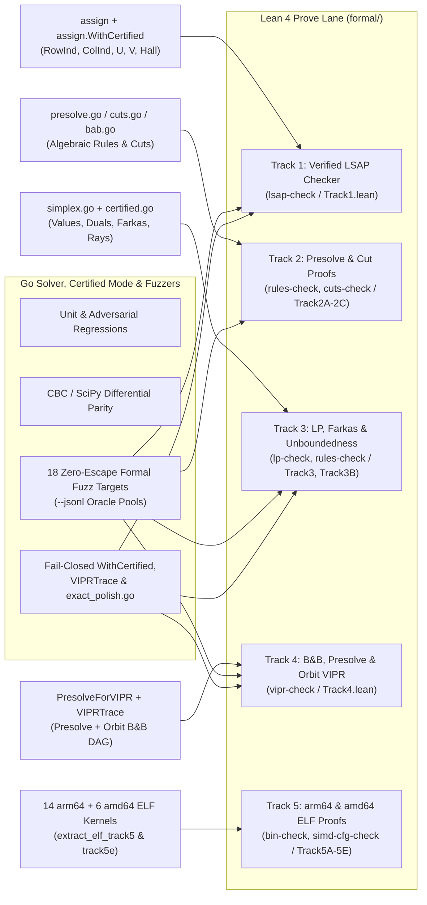

# Formal Verification Architecture (Lean 4 Prove Lane)

The `goblin` Lean 4 Prove Lane certifies solver outputs, enforces opt-in fail-closed runtime rational verification (`WithCertified` and `assign.WithCertified`), proves the soundness of algebraic LP and MILP rules, and verifies compiled binary invariants for pure leaf helpers and SIMD kernels without lifting the Go runtime. Full-program verification of the Go solver, garbage-collected runtime, or floating-point Markowitz `LU` factorization ([`lu.go`](../lu.go)) remains out of scope. All proofs and standalone verifiers live in an isolated Lake workspace ([`formal/`](../formal/lakefile.toml)) pinned to Lean `v4.36.0` with zero external package dependencies, compiling across 75 Lake build jobs with zero warnings (`23` Lean files, `52,743` LOC: `16` library modules in `GoblinFormal` totaling `49,888` LOC and `7` CLI executables in `Apps/` totaling `2,855` LOC, paired with `29` formal, certified, and VIPR Go files totaling `40,618` LOC). Programmatic `Lean.collectAxioms` inspection via `#verify_all_goblin_axioms` across all `5,809` kernel-checked `TheoremInfo` declarations (`1,335` authored `theorem` and `lemma` declarations in `GoblinFormal`: `564` public and `771` private, plus `1` private bounds lemma in `Apps/LsapCheck.lean`) and `207` `#guard_msgs in #print axioms` locks in [`AxiomAudit.lean`](../formal/GoblinFormal/AxiomAudit.lean) confirms `0` `sorryAx`, `0` `Lean.trustCompiler` or `Lean.ofReduceBool`, `0` `_native.bv_decide` or `_native.native_decide` reflection axioms, and `0` custom axioms: every theorem depends solely on `{propext, Classical.choice, Quot.sound}`, independently re-verified by `leanchecker` and `nanoda_bin` without native-axiom exemptions.

---

## 1. Architectural Decision and Boundaries

The `goblin` solver maintains a four-part empirical verification suite: unit and regression tests, differential parity against COIN-OR CBC and SciPy, targeted fuzzers (`fuzz_test.go`, `mad_fuzz_test.go`, `assign/fuzz_test.go`), and scalar-vs-SIMD parity tests. The Lean 4 Prove Lane closes three gaps that empirical testing cannot eliminate:

1. **Result soundness**: machine-checked Lean proofs paired with pure-Go in-process `*big.Rat` and `dyadic2304` verifiers (`WithCertified`, `VerifyVIPRTrace`, `assign.WithCertified`, mirroring the Lean specs without linking Lean into Go binaries) show that concrete primal/dual outputs, exact rational basis duals, bound-conflict witnesses, Hall infeasibility subsets, Meyer recession rays, and presolve-enveloped branch-and-cut proof traces from `goblin` or `goblin/assign` establish global optimality, valid bounds, unboundedness, or infeasibility independent of bugs in the floating-point solver or SIMD kernels.
2. **Rule soundness**: machine-checked proofs over abstract algebraic specifications show that cutting planes, presolve tightenings, Euclidean GCD reductions, LP postsolve dual reconstructions, static and dynamic orbital symmetry breaking, and reference branch-and-bound state transitions preserve feasible solutions and valid dual bounds, while production solver runs certify each concrete instance directly on the caller's `CompiledProblem`.
3. **Compiled-binary and SIMD leaf assurance**: machine-checked proofs directly over `14` compiled `arm64` ELF routines (`-gcflags=-l` standalone leaves, an inline lowering snippet, and single-frame solver kernels up to external `BL` boundaries), `6` decoded `amd64` AVX2/AVX-512 ELF kernels (`530` x86-64/VEX/EVEX instructions), disassembled `amd64` SIMD control-flow graphs, and IEEE-754 vector lane reductions verify pure leaf equivalence, zero heap allocation, structural bounds-guard mediation, `VZEROUPPER`/EVEX/frame ABI invariants, silicon-verified x86-64 NaN semantics, and cross-ISA functional parity.



### Rejected Approaches

We explicitly reject three verification patterns for `goblin`:

- **Direct Go-to-Lean source lifting**: Tools such as Aeneas succeed on Rust because the borrow checker eliminates pointer aliasing and exposes pure functional semantics. Go lacks an ownership type system and a mature Lean source-extraction pipeline; hand-translating imperative Go into Lean creates an unverified translation gap.
- **Full-program binary verification across the Go GC and runtime**: No published work verifies Go's concurrent tri-color mark-and-sweep garbage collector (`runtime.mallocgc`, `runtime.gcWriteBarrier*`) or goroutine scheduler at the machine-code level. State-of-the-art verified GCs (CakeML in HOL4, CertiCoq via CompCert) verify bespoke, single-threaded copying or mark-and-sweep collectors built inside a proof assistant from scratch. Empirical disassembly (`go tool objdump`) of `goblin` confirms that allocating routines such as `verifyExactRationalFarkas` (2,759 instructions) invoke `runtime.makeslice`, `runtime.growslice`, `runtime.mallocgc*`, and `runtime.gcWriteBarrier2`/`3`, which pulls the entire Go runtime into the proof. Binary verification in `goblin` therefore targets only **zero-allocation, GC-free paths** (Track 5), which cover core hot loops thanks to `goblin`'s pre-allocated `Workspace` architecture.
- **Floating-point proof of numerical linear algebra**: Proving IEEE-754 rounding bounds for Markowitz pivoting and Forrest-Tomlin `U` updates ([`lu.go`](../lu.go)) carries extreme proof cost for low defect yield. A posteriori certificate checking verifies solver outputs directly without trusting those internals.
- **Complementary Go-native verifiers (outside Lean)**: If source-level panic-freedom and slice-bounds proofs over allocating Go code are ever needed without Lean ISA models, **Gobra** (ETH Zurich, Viper/SMT) and **Goose/Perennial** (Rocq/Coq) are the established Go-native options. They target Go source rather than compiled binaries and do not replace Lean 4's mathematical certification libraries.

### Verification Strength and Scope Boundaries

- **Strong guarantees and trusted computing base**: When `gb.WithCertified(true)`, `assign.WithCertified(true)`, or the Lean CLI checkers accept an output, global optimality (at exact zero rational gap by default), infeasibility, unboundedness, or dual bounds hold over exact rational arithmetic $\mathbb{Q}$ on the caller's original problem (with exact `Ceil`/`Floor` integer and binary bound tightening in `Model`) independent of floating-point rounding or heuristic bugs. Runtime `WithCertified` and `VerifyVIPRTrace` run pure-Go `*big.Rat` / `dyadic2304` verifiers mirroring the Lean specifications rather than linking Lean binaries into Go; the trusted computing base is the Lean 4 kernel (and `leanchecker`/`nanoda_bin`) plus JSON serialization for CLI checks, or the Go runtime plus `math/big` / `dyadic2304` and [`certified.go`](../certified.go) / [`assign/certified.go`](../assign/certified.go) in process. On the `20` verified `arm64` and `amd64` leaf and single-frame kernels, modeled equivalence, frame/register ABI preservation, structural guard mediation, and allow-listed zero-GC safety hold on Go 1.27's emitted machine bytes with zero non-standard axioms (`{propext, Classical.choice, Quot.sound}` only).
- **Explicit limitations**: Default uncertified solves (`gb.WithCertified(false)`) execute imperative floating-point Go code ([`lu.go`](../lu.go), [`simplex.go`](../simplex.go), [`presolve.go`](../presolve.go), [`cuts.go`](../cuts.go), [`bab.go`](../bab.go), [`heuristics.go`](../heuristics.go)) without Lean source lifting. Track 2 rules, Track 3B `postsolveLPDual`, and Track 4's `BabState` (`activeBounds` and linear-objective gap predicates) prove abstract reference specifications rather than imperative Go state transitions; `--jsonl` differential fuzzing samples bounded regimes rather than exhausting all `float64` inputs; Track 5 `runArm64` stops at external `BL` boundaries, `checkPanicBounds` proves structural guard mediation (`BoundsGuardsHold`) rather than value-level slice-index unreachability, and `Track5B` `*_exec` theorems are single-input concrete overlay tests. Sparse Markowitz `LU`, Forrest-Tomlin updates, simplex anti-cycling and termination, parallel workers (`WithWorkers > 1`), the Go runtime and garbage collector, and vendored C++ CBC (`BackendCBC`) remain outside formal proof scope. Passing `gb.WithCertified(true)` guarantees **soundness** (failing closed with `StatusNumericalError` and `ErrCertificationFailed` whenever an exact witness cannot be extracted or verified), whereas severely ill-conditioned instances can reject witness extraction rather than achieving completeness.

---

## 2. Industry Precedents and Anti-Translation-Gap Rules

The Prove Lane adopts patterns validated by production and research Lean 4 verification systems (2024 to 2026):

| Precedent | Domain | Architecture | Adopted Rule for `goblin` |
| :--- | :--- | :--- | :--- |
| **Google DeepMind AlphaProof Code (`google-deepmind/code-verification`)** | Production cryptographic library (`libsignal`, compiled AArch64 binaries) | Verified unmodified compiled AArch64 Linux machine code directly against open-source Lean 4 AArch64 semantics (`arm64-semantics/`, `ElfRunsTo`, ~6.5M lines of proofs covering ~140k instructions) | Proves that Lean 4 binary verification works on stock compiled ELF code; Track 5 models AArch64 instruction semantics directly in `Track5A.lean`, `Track5B.lean`, and `Track5D.lean` |
| **Anthropic + Theorem (123 OSS-Fuzz libraries)** | Production C/C++ binaries (static single-threaded RISC-V `musl` ELF) | Verified 239 fuzz entry points in Rocq (~180M lines) for bounded crash-freedom (< 64 MB inputs) using Theorem's Linux Process Semantics | Highlights the domain contrast: C/C++ needs crash-freedom proofs, whereas Go already enforces memory safety at runtime; `goblin`'s primary risk is mathematical/optimality soundness (Tracks 1 to 4) |
| **Anthropic FlashProve** (*Provable Inference for LLMs*) | Cryptographic inference verification | Fast C++ execution engine paired with a Lean-verified checker and short, human-auditable top-level theorems | Keep top-level optimality and soundness theorem statements concise and auditable; keep execution speed in Go |
| **`leanprover/lp-verify`, LeanSAT (`bv_decide`), & LeanVIPR** | LP, SAT/Bitvectors, and MILP certification | Untrusted external solver emits a mathematical certificate (dual multipliers, Farkas ray, LRAT, or VIPR trace); pure-Lean checker validates it inside the kernel | Prefer certificate checking wherever `goblin` emits witnesses (`U`/`V` in `assign`, `Duals`/`Farkas`/`UnboundedCertificate` in `simplex.go` and `exact_polish.go`, `VIPRTrace` in `vipr_trace.go`) |
| **AWS Cedar (`cedar-spec`) & Belay (SQLite)** | Cloud authorization (Rust) and SQLite queries/migrations | Small executable Lean 4 semantic specification + formal proofs + high-volume differential testing against the shipping engine | Pair every rule-level Lean model with automated Go-vs-Lean differential fuzzing so implementations cannot drift |
| **`lean-zip` (zlib), `nasa-jpl/L4YAML`, & `conao3/lean-py`** | Compression, YAML 1.2.2 parsing, Python-Lean bridges | Verified Lean 4 kernel compiled natively and invoked through thin host adapters or CLI boundaries | Compile Lean checkers to standalone executables via `lake build`; keep `go test ./...` free of Lean toolchain dependencies |
| **Certora (`zlib` `inflate_table`) & `zksecurity/leanPython`** | Legacy C and Python 3.12 in Lean | Targeted C-to-Lean lifting and unverified Lean re-implementations | Do not confuse writing Lean code with formal verification; every Prove Lane file proves its target invariant with zero `sorry` |

### Three Non-Negotiable Integrity Rules

1. **Zero translation gap via certificates or binary proofs**: Whenever `goblin` emits a witness, the standalone Lean executable or in-process `*big.Rat` / `dyadic2304` runtime verifier checks the output of the actual Go binary against the original problem instance (Tracks 1, 3, and 4). Where a witness is unavailable on a small, pure leaf routine or zero-alloc SIMD kernel, Track 5 verifies the compiled machine code directly against a formal `arm64` or `amd64` ISA/CFG model, while [`scripts/extract_elf_track5.py`](../scripts/extract_elf_track5.py) and [`scripts/extract_amd64_track5e.py`](../scripts/extract_amd64_track5e.py) cross-check every embedded opcode stream, relocation target, `.rodata`/`.data` symbol, and internal fallback callee against fresh ELF builds.
2. **Differential closure for rule specs**: Whenever an abstract theorem covers an internal algorithm (such as GCD row reduction, presolve tightening, LP postsolve dual reconstruction, orbital symmetry, or GMI, lifted cover, lot-sizing, VUB, and multi-row cMIR cuts in Tracks 2, 3B, and 4), live observer hooks (`presolveWithObserver`, `presolveLPWithObserver`, and `cutGenWorkspace.certObs`) export production solver derivations into fail-closed Lean verifiers under `GOBLIN_FORMAL=1` differential tests and zero-escape-hatch `--jsonl` fuzzer pools.
3. **Programmatic axiom audit**: Every proven declaration across all `5,809` kernel `TheoremInfo` entries relies strictly on `{propext, Classical.choice, Quot.sound}` (`0` `sorryAx`, `0` `Lean.trustCompiler`, `0` `_native.bv_decide` or `_native.native_decide`, and `0` custom axioms). The module [`AxiomAudit.lean`](../formal/GoblinFormal/AxiomAudit.lean) enforces `207` `#guard_msgs in #print axioms` locks plus the `#verify_all_goblin_axioms` environment sweep on every `lake build`, complemented by `leanchecker` and `nanoda_bin` external kernel verification.

---

## 3. Implemented Prove Lane Architecture

All Lean 4 proof artifacts live in the isolated Lake workspace ([`formal/`](../formal/GoblinFormal.lean)) so default Go builds and `CGO_ENABLED=0` binaries require zero Lean toolchain dependencies. On the Go side, `5` production files ([`exact_polish.go`](../exact_polish.go) at `2,369` LOC, [`vipr_json.go`](../vipr_json.go) at `1,272` LOC, [`vipr_trace.go`](../vipr_trace.go) at `5,747` LOC, [`certified.go`](../certified.go) at `3,933` LOC, and [`assign/certified.go`](../assign/certified.go) at `1,234` LOC; `14,555` LOC combined) implement exact `*big.Rat` basis polishing, LP/MILP unboundedness extraction, zero-reflection Mini-VIPR JSON codecs, presolve-enveloped and orbital-symmetry `WithVIPRTrace` proof recording, and opt-in fail-closed `WithCertified` / `assign.WithCertified` runtime verification in pure standard-library Go (not linked to Lean CLI binaries) with zero hot-path overhead when disabled, while `24` formal, certified, and VIPR test files (`26,063` LOC) house negative controls, subprocess pools, linker dead-code-elimination checks, and live observer bridges. Functional-option hook decoupling ensures Go's linker eliminates `100%` (`0` bytes) of `certified.go`, `assign/certified.go`, `vipr_trace.go`, `vipr_json.go`, `PresolveForVIPR`, `activeOrbitWithWitnesses`, and `encoding/json` (plus `0` bytes of `math/big` in `goblin/assign`) from binaries that do not reference `WithCertified`, `VerifyVIPRTrace`, `NewVIPRTrace`, or `WithVIPRTrace`.

### Workspace Foundation, Common Library, and Runtime Fail-Closed Certified Mode

- **Toolchain & Lake Configuration**: [`formal/lean-toolchain`](../formal/lean-toolchain) pins `leanprover/lean4:v4.36.0`. [`formal/lakefile.toml`](../formal/lakefile.toml) declares zero external Lake dependencies, builds the 16-file `GoblinFormal` library, and compiles 7 standalone CLI executables in 75 Lake build jobs.
- **Common Arithmetic & Float64 Conversion** ([`Common/Basic.lean`](../formal/GoblinFormal/Common/Basic.lean)): Defines `finSum` over `Rat` and `intFinSum` over `Int` with proven linearity, injection-sum, and divisibility theorems (`finSum_inj_le`, `finSum_inj_eq`, `intFinSum_dvd`). Implements exact IEEE-754 binary64 bit-pattern conversion `float64BitsToRat` to dyadic `Rat` with `float64BitsToRat_isNone_iff` (rejecting Inf/NaN), field decomposition `float64Bits_field_decomp`, and exact IEEE-754 value theorems across normal and subnormal floats (`float64BitsToRat_subnormal`, `float64BitsToRat_normal`, `float64BitsToRat_eq_ieee754`).
- **Pure `Init` Strict JSON Parser** ([`Common/Json.lean`](../formal/GoblinFormal/Common/Json.lean)): Provides a total recursive-descent parser (`JsonVal`, `parseJson`, and duplicate-key-rejecting `parseJsonStrict` via `JsonVal.findDuplicateKey?` across raw and Unicode-escaped keys) without importing the `Lean` compiler package, plus exact rational extractors (`asRat`, `asUInt64`, `getField`) supporting `{"num", "den"}` objects, `"num/den"` strings, and decimal numbers. All seven standalone Lean CLIs enforce `parseJsonStrict`, pre-allocation dimension guards (`10^12` OOM-safe rejection), and non-empty `--batch` validation.
- **Runtime Fail-Closed Certified Mode & Modeling Bounds** ([`model.go`](../model.go), [`certified.go`](../certified.go), [`assign/certified.go`](../assign/certified.go), [`certified_test.go`](../certified_test.go), [`assign/certified_test.go`](../assign/certified_test.go)):
  1. **Exact Integer Bounds & Zero-Gap Defaults (`WithCertified(true)`, `VerifyVIPRTrace`, `ErrCertificationFailed`)**: In [`model.go`](../model.go), `roundBoundsForCategory` tightens `Integer` and `Binary` variable bounds via exact `math.Ceil(lb)` and `math.Floor(ub)` without outward `1e-12` relaxation, and [`bab.go`](../bab.go) enforces exact integer activity on integer-coefficient inequality rows. Passing `WithCertified(true)` to `Model.Solve` or `SolveCompiled` runs pure-Go `*big.Rat` verification directly against the caller's original `CompiledProblem` (`0` allocations on `ApplyOptions()` and `WithCertified(false)`) and defaults unset gap tolerances to exact zero (`RelGapTol = 0`, `AbsGapTol = 0`) unless explicitly overridden via `WithRelGapTol` or `WithAbsGapTol`. Pure LPs certify `StatusOptimal` at zero rational duality gap via `ExactBasisSolution`/`ExactBasisDuals` and exact user-frame `ReducedCosts` (or within explicit gap overrides via `ExactSafeDualBound`), `StatusInfeasible` via exact Farkas rays or bound-conflict witnesses, `StatusUnbounded` via `VerifyUnboundedCertificate`, and resource-limit exits via exact primal and `BestBound` validation. Mixed-integer solves record a single-threaded presolve-enveloped `VIPRTrace` (falling back to unpresolved `p` if needed) and validate it in-process through `VerifyVIPRTrace` (`mode = "optimal"` zero rational gap by default, with bit-exact `float64` matching under `WithCertified(true)`), plus Meyer integer-scaled unboundedness rays. Any missing or rejected witness clears unsafe primal/dual/objective/bound fields, sets `StatusNumericalError`, and returns `ErrCertificationFailed`.
  2. **Combinatorial Assignment (`assign.WithCertified(true)`, `assign.ErrCertificationFailed`)**: Passing `assign.WithCertified(true)` to `LinearSum`, `LinearSumFlat`, or `SolveInto` preserves `0 allocs/op` on `SolveInto` when disabled and verifies matching cardinality, injectivity, finite edge costs, exact 2304-bit fixed-point dyadic objective sums (`dyadic2304`), and global optimality (fast-path exact reduced costs and complementary slackness over $2^{-1074} \mathbb{Z}$, falling back to exact dyadic residual bipartite Bellman-Ford negative-cycle and augmenting-path checks under ULP dual drift or `+Inf`/`-Inf` forbidden edges). While optimality is certified over exact 2304-bit dyadic rationals, `Result.U` and `Result.V` hold finite `float64` representations (repaired and floored when necessary so $U_i + V_j \le C_{ij}$ holds over $\mathbb{Q}$). On `ErrInfeasible`, the verifier constructs via Hopcroft-Karp and checks a Hall subset $S$ with $|N_{\text{finite}}(S)| < |S|$, returning `assign.ErrCertificationFailed` (and filling `-1` match indices in `SolveInto`) on any failure.
  3. **Linker Dead-Code Elimination (`TestGoblinBinaryDeadCodeElimination`, `TestAssignBinaryDeadCodeElimination`)**: `WithCertified`, `assign.WithCertified`, and `WithVIPRTrace` install internal hook pointers on `Options` rather than referencing verification or proof-recording entrypoints from `solve.go`, `bab.go`, or `assign/assign.go`. Passing `Certified: true` via a struct literal without `WithCertified(true)` fails closed with `ErrCertificationFailed`, while default production binaries that omit certified and VIPR options link `0` symbols from `certified.go`, `assign/certified.go`, `vipr_trace.go`, `vipr_json.go`, `PresolveForVIPR`, `encoding/json`, or (in `goblin/assign`) `math/big`.

### Track 1: Verified LSAP Optimality & Hall Infeasibility Checker (`goblin/assign`)

- **Target surface**: `Result{RowInd, ColInd, Objective, U, V}` in [`assign/assign.go`](../assign/assign.go) and dual/infeasibility invariants in [`assign/solver.go`](../assign/solver.go) and [`assign/certified.go`](../assign/certified.go) across square ($m = n$), wide ($m < n$), tall ($m > n$ via transposition), and forbidden-edge (`+Inf`/`-Inf`) cost matrices.
- **Executable checker** ([`Track1.lean`](../formal/GoblinFormal/Track1.lean)): `checkLSAP`, `checkLSAPTranspose`, and native `Option Rat` forbidden-edge checkers `checkLSAPForbidden` and `checkLSAPForbiddenTranspose` validate assignment injectivity, finite edge selection, dual feasibility ($u_i + v_j \le C_{ij}$ on all finite cells), rectangular dual invariants ($v_j \le 0$ and $v_j = 0$ on unassigned columns when $m < n$; $u_i \le 0$ and $u_i = 0$ on unassigned rows when $m > n$), and complementary slackness ($u_i + v_{p(i)} = C_{i, p(i)}$). Safe variants (`checkLSAPSafe`, `checkLSAPForbiddenSafe`, `checkLSAPForbiddenTransposeSafe`) compute `safeLowerBound` within drift-free tolerance `tol` (`safe_objective_within_tol`), while `checkHallInfeasible` and `checkHallInfeasibleTranspose` validate bipartite Hall subsets $|N_{\text{finite}}(S)| < |S|$.
- **Top-level theorems**: `dual_lower_bound`, `checkLSAP_sound`, `checkLSAP_sound_max`, `checkLSAPTranspose_sound`, `checkLSAPForbidden_sound`, `checkLSAPForbiddenSafe_sound`, `checkLSAPForbiddenTranspose_sound`, `checkHallInfeasible_sound`, and `checkHallInfeasibleTranspose_sound` prove global finite-edge optimality, dual lower bounds, and Hall infeasibility without big-$M$ distortion.
- **CLI & Tests**: [`lsap-check`](../formal/Apps/LsapCheck.lean) echoes `VERIFIED mode=<exact|safe|hall>` (with `tol=<rat>` on primal-dual modes) across single-file, `--jsonl`, and `--batch` invocations, supporting native `null`/`"+Inf"`/`"-Inf"`/`{"forbidden":true}` forbidden cells and compact integer bit encodings across [`assign/formal_lsap_test.go`](../assign/formal_lsap_test.go), [`assign/formal_fuzz_bridge_test.go`](../assign/formal_fuzz_bridge_test.go), and [`assign/formal_adversarial_regression_test.go`](../assign/formal_adversarial_regression_test.go).

### Track 2: Soundness Proofs for MILP Presolve, Symmetry, and Cutting Planes

Track 2 formalizes abstract mathematical specifications of `goblin`'s presolve reductions and cutting-plane families over exact rationals $\mathbb{Q}$, paired with nil-guarded production observer hooks (`presolveWithObserver` in [`presolve.go`](../presolve.go) and `cutGenWorkspace.certObs` in [`cuts.go`](../cuts.go)) that export live solver derivations into fail-closed `rules-check` and `cuts-check` verifiers:

- **Track 2A (Presolve & Symmetry)** ([`Track2A.lean`](../formal/GoblinFormal/Track2A.lean), [`rules-check`](../formal/Apps/RulesCheck.lean)):
  1. **GCD Equality Infeasibility & `divCeil`** ([`bab.go`](../bab.go), `hasInfeasibleIntegerEqRow`, `divCeilInt64`): `divCeilSpec_spec` proves exact ceiling division across negative dividends; `gcd_row_infeasible_sound`, `gcd_row_infeasible_tol_sound`, and `hasInfeasibleIntEqSpec_sound` prove no integer vector satisfies $\text{lo} \le \sum_j a_j x_j \le \text{hi}$ when $g \mid a_j$ and $\lceil \text{lo} / g \rceil \cdot g > \text{hi}$.
  2. **Activity Tightening & Skipping** ([`presolve.go`](../presolve.go), `evalRowActivitySummary`, `residualQuotient`, `presolveCanSkipTerm`): `evalActivitySummarySpec_sound`, `activity_implied_upper_sound`, and `activity_implied_lower_sound` prove implied variable bounds over `Option Rat` (failing closed in `rules-check` whenever no implied bound exists); `presolveCanSkipTerm_sound` and `presolveCanSkipTerm_lower_sound` prove skip safety.
  3. **Binary Coefficient Strengthening** ([`presolve.go`](../presolve.go)): `binary_strengthen_pos_iff`, `binary_strengthen_pos_outward_sound`, `binary_strengthen_neg_iff`, and `checkBinStrengthenFromRowSpec_sound` prove equivalence and outward rounding soundness, computing exact `max_other` directly from row `terms` and rejecting spoofed `max_other` or invalid proposals.
  4. **Orbital Symmetry Breaking** ([`presolve.go`](../presolve.go), `applyOrbitSymmetryBreaking`, `verifyOrbitSymmetry`, `detectDynamicNodeOrbit`): `orbit_automorphism_preserves_opt`, `monotone_orbit_order_sound`, `verifyOrbitSymmetrySpec_sound`, and multi-element $S_G$ chain/orbitope theorems (`orbit_chain_ordering_forced_zero_sound`, `orbit_exact_chain_ordering_sound`, `orbit_orbitope_upper_tri_sound`, `orbit_bijective_identity_sound`) prove that ordering variables under verified group symmetries preserves optimal MILP objective values, failing closed on invalid symmetries.
- **Track 2B (Core Cutting-Plane Soundness)** ([`Track2B.lean`](../formal/GoblinFormal/Track2B.lean), [`cuts-check`](../formal/Apps/CutsCheck.lean)):
  1. **GMI Tableau Cuts** ([`cuts.go`](../cuts.go), `separateGMICutsEx`): `gmi_cut_sound`, `gmi_weaken_upward_sound`, and `checkTableauGMI_sound` prove validity for all feasible mixed-integer solutions with non-negative non-basic slacks.
  2. **Row Aggregation & Single-Row cMIR Cuts** ([`cuts.go`](../cuts.go), `separateCMIRFromSparseRow`, `mirUseLower`, `rowLegalMuSign`): `row_agg_legal_sound`, `row_agg_sum_sound`, `row_agg_error_bound_sound`, and `checkRowAgg_sound` prove multiplier sign legality and algebraic aggregation validity; `mir_fundamental_ineq`, `mir_cut_sound`, `cmir_safe_rounded_sound`, `cmir_complement_sound`, and `checkCMIRCertificate_sound` prove complementation, MIR cut validity, and outward safe rounding.
  3. **VUB Disaggregation & Cut Cleanup** ([`cuts.go`](../cuts.go), `separateFlowAndVUBCuts`): `vub_disagg_sound`, `vub_disagg_opt_sound`, `checkVUBDisagg_sound`, and `cut_drop_scale_sound` prove algebraic disaggregation and coefficient-drop validity. Witness-only `cuts` payloads in `gmi-check`, `cmir-check`, and `vub-check` fail closed.
- **Track 2C (Universal Structural GMI/VUB, Knapsack Cover, Lot-Sizing, Aggregated cMIR, & Cut-Drop Soundness)** ([`Track2C.lean`](../formal/GoblinFormal/Track2C.lean), [`cuts-check`](../formal/Apps/CutsCheck.lean)):
  1. **Structural GMI & VUB Certificates (`gmi-check`, `vub-check`)**: `checkStructuralGMICert_sound` and `checkStructuralVUBCert_sound` verify tableau row derivations (`rho` + `baseRows`) and binary VUB rows directly against `MIPFeasible`.
  2. **Lifted Minimal Knapsack Covers (`cover-check`)** ([`cuts.go`](../cuts.go), `separateCoverFromSparseRow`): `knapsack_cover_sound`, `lifted_knapsack_cover_sound`, and `checkKnapsackCoverCert_sound` verify `isInt`, `baseRows`, binary complementation, continuous/non-binary bound relaxation, minimal cover conditions, and sequential DP up-lifting over `MIPFeasible`.
  3. **Lot-Sizing `(l, S)` Flow-Chain Cuts (`lotsizing-check`)** ([`cuts.go`](../cuts.go), `separateFlowAndVUBCuts`): `vub_zero_forces_prod_zero`, `lot_sizing_lS_sound`, and `checkLotSizingCutCert_sound` verify `isInt`, `lb`, `ub`, `baseRows`, non-aliased flow/inventory column distinctness (allowing shared binary setup `binCol`), and Barany-Van Roy-Wolsey flow-conservation suffix-sum inequalities over `MIPFeasible`.
  4. **Multi-Row Aggregated & Pairwise-Surrogate cMIR (`agg-cmir-check`)** and **`finalizeSparseCut` Drop (`drop-check`)**: `row_agg_error_bound_opt_sound`, `agg_row_cmir_sound`, and `checkAggCMIRCert_sound` compose multi-row aggregation with `cmir_safe_rounded_sound`, while `dropMinTerm_le`, `finalize_cut_drop_universal_sound`, and `checkFinalizedCutCert_sound` verify universal term dropping and positive scaling, all guarded by pre-allocation length checks against `10^12` OOM/OOB inputs.
- **Live observer bridges**: [`formal_track2_live_export_test.go`](../formal_track2_live_export_test.go) (`ExportLiveSeparatedCutsItems`), [`formal_export_test.go`](../formal_export_test.go) (`ExportPresolveRulesItems`, `ExportSeparatedCutsItems`), [`formal_track2a_test.go`](../formal_track2a_test.go), [`formal_track2b_test.go`](../formal_track2b_test.go), and [`formal_track2c_test.go`](../formal_track2c_test.go) stream live `Presolve` and `cuts.go` derivations directly to `rules-check` and `cuts-check` without test-side RHS rewrites.

### Track 3: Verified LP Optimality, Farkas & Bound-Conflict Infeasibility, Unboundedness, and Presolve Postsolve

- **Target surface**: `Result.Values`, `Result.Duals`, and `Result.ReducedCosts` in [`solve.go`](../solve.go), `verifyUnscaledFarkas` and `verifyExactRationalFarkas` in [`simplex.go`](../simplex.go), `postsolveLP` and Euclidean GCD row reduction in [`presolve.go`](../presolve.go), and exact `*big.Rat` basis polishing and unboundedness extraction in [`exact_polish.go`](../exact_polish.go).
- **Track 3 Core LP, Farkas, & Bound-Conflict Checker** ([`Track3.lean`](../formal/GoblinFormal/Track3.lean), [`lp-check`](../formal/Apps/LpCheck.lean)): Supports `optimal`, `safe-bound`, `farkas`, and `bound-conflict` modes across single-file, `--jsonl`, and `--batch` execution, echoing the verified `MODE` on output, rejecting CLI-vs-JSON mode mismatches, and requiring a feasible primal vector `x` matching `LPObjective` whenever `safe-bound` specifies `primalObj`/`upperObj` or non-negative `gapTol`. Top-level theorems `checkPrimalFeasible_sound`, `safeDualBound_sound`, `checkLPOptimal_sound`, `checkFarkas_sound`, and `checkBoundConflict_sound` (finite $lb_j > ub_j$) establish certificate soundness on original `LPInstance`.
- **Track 3B Unboundedness, GCD Row Division, & Reference LP Presolve Dual Postsolve** ([`Track3B.lean`](../formal/GoblinFormal/Track3B.lean), [`lp-check`](../formal/Apps/LpCheck.lean), [`rules-check`](../formal/Apps/RulesCheck.lean)):
  1. **LP & MILP Meyer Unboundedness (`lp-check` modes `unbounded` and `milp-unbounded`)**: `checkRecessionRay_sound`, `rayPoint_primalFeasible`, and `checkLPUnbounded_sound` verify a primal-feasible anchor $x_0$ and improving recession ray $d$; `checkIntegrality_sound`, `rayPoint_nat_integrality`, and `checkMILPUnbounded_sound` verify LCM-scaled integer rays while rejecting zero-integer-column or conflicting `isInt`/`intCols` payloads.
  2. **MIP Euclidean GCD Row Division (`rules-check` subcommand `gcd-div-check`)**: `gcd_row_div_sound`, `evalGcdRowDiv_checkGcdRowDiv`, and `evalGcdRowDiv_sound` prove exact integer solution-set equivalence and infeasibility on non-divisible equalities, matching `presolve.go` exact `Floor`/`Ceil` scaling when `maxRoundErr == 0`.
  3. **Reference LP Presolve & Postsolve Specification (`lp-check` mode `lp-presolve`)**: `postsolveLPDual`, `lp_presolve_primal_lift`, `lp_presolve_safeDualBound_eq`, `lp_presolve_dual_sound`, and `lp_presolve_chain_dual_sound` formalize an abstract reference specification for `fixedSubst`, `singletonRow`, `dualColFix`, `zeroObjEmptyColFix`, and `dropRedundantRow` (always validating primal feasibility of `xReduced` and lifted `xOrig` even when `yReduced` is omitted), exercised against live `presolveLPWithObserver` chains via `ExportLPPresolveCheckPayload`, while production `WithCertified(true)` certifies LPs directly on original `CompiledProblem`.
- **Fixtures & Tests**: Verified on [`lp_optimal_sample.json`](../testdata/formal/lp_optimal_sample.json), [`lp_farkas_sample.json`](../testdata/formal/lp_farkas_sample.json), [`formal_track3_test.go`](../formal_track3_test.go), [`formal_track3b_test.go`](../formal_track3b_test.go), [`formal_parallel_adversarial_test.go`](../formal_parallel_adversarial_test.go), and `ExportLPCheckPayload` / `ExportLPPresolveCheckPayload` / `ExportUnboundedCheckPayload` in [`formal_export_test.go`](../formal_export_test.go).

### Track 4: Reference B&B State Machine, Presolve & Orbital-Symmetry Mini-VIPR, and `VIPRTrace`

- **Abstract Reference Branch-and-Bound State Machine** ([`Track4.lean`](../formal/GoblinFormal/Track4.lean) Section 2): Models `BabState` (`openQueue`, `plungeNode`, `activeBounds` for in-flight parallel workers, `bestObjMin`, `prunedMinBound`, `unsolvedMinBound`, and linear-objective `isGapClosedSpec` / `exactGapClosedSpec` using $\max(1, |\sum_j c_j x_j|)$ without `objConst` inflation) as an abstract design specification of global bound accounting rather than a direct source lift of imperative `bab.go`. Proves invariant preservation (`ValidBabState`), global bound soundness (`bestBound_global_valid`, `infeasible_when_globalBound_none`), worker lease monotonicity (`stepWorkerAcquire_valid`, `stepWorkerFinish_valid`), reduced-cost fixing (`rc_fixing_sound`, `stepReducedCostFix_valid`), budget abort safety (`stepBudgetAbort_valid`), and optimality upon gap closure (`stepGapClosed_optimal`, `stepGapClosed_exact_optimal`, `exactGapClosedSpec_sound`). Concrete solver executions are certified per-instance on `CompiledProblem` via `VIPRTrace`.
- **Mini-VIPR Trace Verifier with Orbital Symmetry & Verified Presolve Envelopes** ([`Track4.lean`](../formal/GoblinFormal/Track4.lean), [`vipr-check`](../formal/Apps/ViprCheck.lean)): Verifies rational MILP derivation DAGs (`conIndex`, `lincomb`, `roundUp`, `roundDown`, `assume`, `farkas`, `boundConflict`, `safeDual`, `dualBound`, `branch`, and `orbitBranch`) with strict assumption scoping across `infeasible`, `optimal`, and `bound` modes:
  1. **Node-Level Orbital Symmetry (`StepRule.orbitBranch`)**: Validates `OrbitWitness` column/row permutation bijections (`checkPermBijection_spec`, `checkConPermImplies_sound`, `checkOrbitAutomorphism_sound`) that fix companion binaries $x_c \le 0$ alongside $x_{\text{br}} \le 0$ on the left branch while discharging permuted active node bounds and cuts via `supportEntries` and `extraAsms` on the right branch.
  2. **Verified `orig -> reduced` Presolve Envelope (`VIPRWithPresolveCert`)**: Models `PresolveState` and nine exact rational `PresolveStep` reductions (`roundBound`, `activityBound`, `gcdRowDiv`, `substFixedRow`, `substFixedObj`, `singletonRowElim`, `redundantRow`, `binStrengthen`, and `symBreakLe` under `checkPermInvolution_spec`). Top-level theorems `applyPresolveStep_sound`, `runPresolveSteps_sound`, `checkVIPRInstanceEq_sound`, `checkVIPRWithPresolve_sound`, `checkVIPRWithPresolve_infeasible_sound`, `checkVIPRWithPresolve_optimal_sound`, constructive primal-lifting `checkVIPRWithPresolve_optimal_constructive_sound` / `checkVIPRWithPresolve_optimal_same_n_sound` (`checkVIPRWithPresolve_dim_eq`), linear-gap `checkVIPRWithPresolve_eps_optimal_sound` / `checkVIPRWithPresolve_eps_optimal_zero_tol`, and `checkVIPRWithPresolve_bound_sound` certify feasibility, optimality, and bounds directly on `cert.orig`.
- **Zero-Observer-Effect `VIPRTrace` Export** ([`vipr_trace.go`](../vipr_trace.go), [`presolve.go`](../presolve.go), [`solve.go`](../solve.go), [`bab.go`](../bab.go)): Configuring `WithVIPRTrace(tr)` on `NewVIPRTrace()` records an exact `*big.Rat` proof DAG during single-threaded `BackendGo` Branch-and-Cut without disabling presolve, orbital symmetry, cuts, or RCF:
  1. **Exact MIP presolve & live orbital branching**: When `EnablePresolve` is active, `solveCompensatedEngine` runs exact-rational `PresolveForVIPR` (`VIPRPresolveEnvelope`, `SetPresolveEnvelope`, `RecordPresolveInfeasibleEnvelope`) so `tr.TracedProblem() == p` holds on the original `CompiledProblem` (with automatic unpresolved fallback on numerical edge cases), while `bab.go` (`createChildNodesWithOrbit` and `filterVerifiedOrbitCompanions`) emits verified `orbitBranch` steps across static and dynamic node orbits.
  2. **Certified root and in-tree cutting planes**: `runRootCutLoop` and `tryInTreeCuts` remain active under tracing, certifying tableau Chvatal-Gomory cuts, Case 1 `lincomb` and Case 2 5-step binary `branch` VUB disaggregations, single-row CG/MIR cuts, and CG rank-1 lifted minimal knapsack covers through `verifyGlobalCutRat`, plus exact integer row-activity conflict Farkas derivations (`certifyRowActivityFarkas`).
  3. **Purged-cut index preservation**: `VIPRTrace` maintains append-only `allCuts` paired with synced `activeCutIDs` (`snapshotActiveCuts`, `restoreActiveCuts`, `addCertifiedCutPlanes`, `purgeSlackCuts`), active-cut-aware `solveBasisTransposeActive` / `extractNodeSafeDualActive` / `extractNodeFarkasActive` over sparse `[]viprRowMult` multipliers, and transitive `collectNeededCuts` emission in `finalize`.
  4. **Certified RCF, unbounded integer tightening, & raised caps**: Root RCF, in-tree RCF, and `tightenUnboundedIntCols` certify each bound tightening (`certifyAndApplyRCF`, `certifyAndApplyUnboundedIntTightening`) via `StepRule.branch`, while branching encodes arbitrary-precision `*big.Int` split bounds (`viprFloorBigInt`, `viprCeilBigInt`) under raised caps (`viprMaxPropRowLen = 512`, `viprMaxRatDenomBits = 2048`, `viprMaxNucleusSize = 1024`), LCM-cleared GCD infeasibility (`buildGCDInfeasSteps`), and singleton-integer leaf resolution (`resolveFixedIntLeaf`).
- **Fixtures & Tests**: Verified on [`vipr_sample.json`](../testdata/formal/vipr_sample.json), [`formal_track4_test.go`](../formal_track4_test.go), [`certified_test.go`](../certified_test.go), [`formal_oracle_pool_test.go`](../formal_oracle_pool_test.go) (`TestFormalVIPRBoundMode`), [`formal_parallel_adversarial_test.go`](../formal_parallel_adversarial_test.go) (`TestFormalParallelBoundAndOptimumInvariants`), and [`vipr_trace_test.go`](../vipr_trace_test.go).

### Track 5: Direct Binary Verification of Zero-Alloc `arm64` and `amd64` ELF Kernels

- **Automated `GOARCH=arm64` & `GOARCH=amd64` ELF Extractors** ([`scripts/extract_elf_track5.py`](../scripts/extract_elf_track5.py), [`scripts/extract_amd64_track5e.py`](../scripts/extract_amd64_track5e.py)): Portable Python 3 CLIs that compile reproducible `-trimpath` `CGO_ENABLED=0 GOOS=linux` ELF64 binaries (`GOARCH=arm64` and `GOARCH=amd64 GOAMD64=v1 GOEXPERIMENT=simd`), parse `.symtab`, `.text`, `.rodata`, and `.data` against `go tool objdump` and `go tool nm`, and verify (`--verify`) all `14` `arm64` routines (`57` `.rodata` float64 constants, `4` static data symbols, and `5` internal fallback callees checked against `ALLOWED_ZEROGC_SYMS`) across `Track5A`/`5B`/`5D` plus all `6` `amd64` AVX2/AVX-512 kernels in `Track5E`.
- **Tier 5A (ARM64 Pure Leaf Equivalence)** ([`Track5A.lean`](../formal/GoblinFormal/Track5A.lean)): Implements an AArch64 instruction decoder and single-frame operational semantics (`Arm64State`, `runArm64`, modeling execution up to external `BL` boundaries, trapping `.trapIllegal` on unallocated encodings such as `SDIV`/`UDIV` bit-29 `S = 1`, non-`X30` `RET`, out-of-bounds `PC`, and unmodeled FP opcodes, with exact 32-bit/64-bit `NZCV` flags and Arm `FPProcessNaNs` sNaN quieting). Proves bit-exact equivalence across `4` standalone `-gcflags=-l` Go 1.27 leaf helpers (`splitmix64_arm64_equiv`, `canonicalFloatBits_arm64_equiv`, `divCeilInt64_arm64_equiv`, `gcdInt64_arm64_equiv`) plus the inline-lowering snippet `canonicalFloatBitsInlinedWords` (`canonicalFloatBitsInlined_arm64_equiv`).
- **Tier 5B (Zero-Alloc Single-Frame Solver Kernels)** ([`Track5B.lean`](../formal/GoblinFormal/Track5B.lean), [`bin-check`](../formal/Apps/BinCheck.lean)): Verifies `5` compiled Go 1.27 `arm64` solver routines (`hasInfeasibleIntegerEqRow`, `assign.augmentRowScalar`, `internal/simd.InitReducedRow64`, `assign.refillQueueIndirectScalar`, `assign.relaxRowIndirectScalar`) up to external `BL` boundaries against a fail-closed `allowedZeroGCSyms` allow-list (`checkZeroGC_run_sound`), bounded frame/prologue stack-headroom checks (`checkStackGuard_sound`), and structural bounds-guard mediation (`checkPanicBoundsReachability_run_safe` over `BoundsGuardsHold`, proving every path to `runtime.panicBounds` traverses a non-degenerate, distinct-operand flag comparison and conditional branch rather than tautological `CMP X0, X0`, without claiming value-level slice-bounds unreachability), alongside single-input concrete overlay execution tests (`hasInfeasibleIntegerEqRow_infeasible_gcd_exec`, `hasInfeasibleIntegerEqRow_feasible_gcd_exec`, `augmentRowScalar_concrete_exec`).
- **Tier 5C (amd64 SIMD ISA and CFG Safety)** ([`Track5C.lean`](../formal/GoblinFormal/Track5C.lean), [`simd-cfg-check`](../formal/Apps/SimdCfgCheck.lean)): Mirrors [`cmd/goblin-optcheck/main.go`](../cmd/goblin-optcheck/main.go) vector disassembly checks over inductive CFG operational semantics (`normalizeX86PrefixOpArgs` across `notrack`, `bnd`, `rep*`, `lock`, segment/size, and `rex*` prefixes). The soundness theorem `checkVectorCFG_sound` proves that every reachable legacy SSE transition, `RET`, `CALL`, external conditional/tail jump, and function exit starts with clean upper YMM/ZMM bits (`VZEROUPPER`), fails closed on indirect/unresolved jumps or Plan 9 syntax, and requires explicit CPU feature symbol guards (`hasAVX512` / `x86HasAVX512` / `activeTier`, not arbitrary stack-prologue or length `jcc` jumps) before any EVEX register (`%xmm16..31`, `%ymm16..31`, `%zmm*`), `{z}` mask, or EVEX mnemonic (`50` vector functions across `2,178` deduplicated module functions verified in `TestFormalTrack5_SimdCfgCheck`: `50 / 174` in `./internal/simd`, `44 / 1,844` in `.`, and `40 / 826` in `./assign`).
- **Tier 5D (LSAP Cancellation ELF Proofs & IEEE-754 SIMD `Min2`/Lane Equivalence)** ([`Track5D.lean`](../formal/GoblinFormal/Track5D.lean), [`bin-check`](../formal/Apps/BinCheck.lean), [`formal_track5d_test.go`](../formal_track5d_test.go)):
  1. **LSAP `TwoSum`, `exactReducedCost`, & Kahn DAG ELF Safety (`5` routines, all registered in `bin-check`)**: Extends `Track5A` scalar FP semantics (`Arm64InsnD`, `stepArm64D_proxy_status_pc`, `FNMADD`/`FNMSUB` decode, and `0 * Inf + qNaN` handling), proving `twoSumAssign_arm64_equiv`, `checkFramelessLeaf_run_sound`, `exactReducedCost_and_leaves_elf_safe`, `exactReducedCostNoinline_elf_safe`, `hasPotentialCancellation_elf_safe` (1,353 instructions, allow-listed zero-GC calls, 832-byte stack headroom, and 56 structurally guarded `runtime.panicBounds` branches), and `hasPotentialCancellation_exactD_zeroGC_and_pb` across `assign.twoSumAssign`, `assign.clampFinite`, `-gcflags=-l` and frameless `assign.exactReducedCost`, and `assign.hasPotentialCancellation`.
  2. **Functional IEEE-754 SIMD Lane & `Min2` Tree-Reduction Equivalence**: Models `BitVec 64` sign-magnitude `totalOrder` (`f64TotalKey`) and IEEE-754 numeric ordering (`f64NumKey`, `canonZero64`, `vminpdLane`), bridging `f64Lt` to `Track5A.f64Cmp` (`f64Lt_eq_f64Cmp_n`) and proving `signed_zero_and_subnormal_audit`, `vminpdLane_signed_zero_asymmetry`, `vminpdLane_numKey_assoc_comm`, `mergeMin2` commutativity/associativity (`insertEntry_comm`, `insertEntry_dropThird`, `mergeMin2_insert`), 4-lane AVX2 and 8-lane AVX-512 tree-reduction equivalence to sequential `scalarMin2Fold` (`simdTree4Reduce_eq_scalarMin2Fold`, `simdTree8Reduce_eq_scalarMin2Fold`), witness/minimality soundness (`scalarMin2Fold_witness_and_minimality`), and `GreaterEqual` filter soundness (`min2FilteredStep_eq_scalarMin2Step`).
- **Tier 5E (Decoded `amd64` AVX2 & AVX-512 Machine-Code Equivalence)** ([`Track5E.lean`](../formal/GoblinFormal/Track5E.lean), [`formal_track5e_test.go`](../formal_track5e_test.go)): Implements a pure-Lean variable-length x86-64 + 2-/3-byte VEX (`C5`/`C4`) + 4-byte EVEX (`62` with `k0..k7` opmasks, `{z}` zeroing, Tuple1 `disp8 * 8` `{1to8}` broadcast, full 32-predicate `x86VcmppdPred`, EVEX.W/rounding checks, `ZMM16..31`-preserving `VZEROUPPER`, and silicon-verified Intel SDM `x86F64Sub`/`x86F64Add` NaN propagation preserving second-operand NaN signs/payloads and `-QNaN` `0xfff8000000000000` on `Inf - Inf`) byte decoder and machine state (`Amd64VecState`, `runAmd64Vec`) over `6` stock compiled `GOEXPERIMENT=simd` ELF kernels (`530` instructions total: `allAbsLE64AVX2`, `allAbsLE64AVX512`, `minNoNaN64AVX2`, `minNoNaN64AVX512`, `initReducedRow64AVX2`, `initReducedRow64AVX512`). Proves complete byte decoding (`*_decodes`, `evex_broadcast_and_zeromask_decode_witness`), zero-GC, `VZEROUPPER`, and `RSP = RSP_0 + 8` / `RBP` / `R14` / `XMM15` ABI preservation (`checkDecodedAbiSafety_sound`, `checkDecodedFrameAbi_sound`, `*_abi_and_zeroGC_safe`, `*_abi_reg_preserved`, `stripped_vzeroupper_rejected`), IEEE-754 `Track5D` lane bridges (`vminpd_track5d_canon_bridge`, `minsd_por_eq_f64Min`), and full register/memory functional equivalence plus AVX2-vs-AVX-512 parity across arbitrary vector loops, scalar tails, `-0.0`/`+0.0`, subnormals, `+-Inf`, and hardware `NaN` bit patterns (`allAbsLE64AVX2_functional_equiv`, `allAbsLE64AVX512_functional_equiv`, `allAbsLE64_avx2_eq_avx512_mult8`, `minNoNaN64AVX2_functional_equiv`, `minNoNaN64AVX512_functional_equiv`, `minNoNaN64_avx2_eq_avx512`, `initReducedRow64AVX2_functional_equiv`, `initReducedRow64AVX512_functional_equiv`, `initReducedRow64_avx2_eq_avx512_mult8`).
- **ELF, CFG, & Silicon Parity Tests**: [`formal_track5_test.go`](../formal_track5_test.go), [`formal_track5d_test.go`](../formal_track5d_test.go), and [`formal_track5e_test.go`](../formal_track5e_test.go) (`TestFormalTrack5E_HardwareNaNParity`) validate live `arm64` and `amd64` ELF kernels, hardware NaN payload/sign parity, and adversarial negative controls (`makemap`, `RET X1`, `CMP X0, X0`, `SDIV` S-bit, stack-prologue EVEX, `notrack` indirect jumps, `%ymm17`, `VPTERNLOGQ`, duplicate keys, and stripped `VZEROUPPER`).

### Summary Matrix of Modules, Declarations, Executables, and Theorems

| Component | Module / App | Decls (`Auth / Pub / Kernel`, Locks) | Key Top-Level Theorems | Go Test & Oracle Harness |
| :--- | :--- | :--- | :--- | :--- |
| **Common** | [`Common/Basic.lean`](../formal/GoblinFormal/Common/Basic.lean), [`Common/Json.lean`](../formal/GoblinFormal/Common/Json.lean) | `60 / 49 / 264` (`7`) | `finSum_inj_le`, `finSum_inj_eq`, `intFinSum_dvd`, `float64BitsToRat_isNone_iff`, `float64BitsToRat_eq_ieee754` | [`formal_common_test.go`](../formal_common_test.go), [`formal_oracle_pool_test.go`](../formal_oracle_pool_test.go) |
| **Track 1 (LSAP)** | [`Track1.lean`](../formal/GoblinFormal/Track1.lean), `lsap-check` | `48 / 42 / 110` (`16`) | `checkLSAP_sound`, `checkLSAPTranspose_sound`, `checkLSAPForbidden_sound`, `checkHallInfeasible_sound`, `safe_objective_within_tol` | [`assign/certified.go`](../assign/certified.go), [`assign/formal_lsap_test.go`](../assign/formal_lsap_test.go), [`assign/formal_fuzz_bridge_test.go`](../assign/formal_fuzz_bridge_test.go) |
| **Track 2A (Presolve)** | [`Track2A.lean`](../formal/GoblinFormal/Track2A.lean), `rules-check` | `83 / 44 / 324` (`20`) | `divCeilSpec_spec`, `hasInfeasibleIntEqSpec_sound`, `evalActivitySummarySpec_sound`, `checkBinStrengthenFromRowSpec_sound`, `verifyOrbitSymmetrySpec_sound`, `orbit_chain_ordering_forced_zero_sound` | [`formal_track2a_test.go`](../formal_track2a_test.go), [`formal_export_test.go`](../formal_export_test.go), [`formal_adversarial_regression_test.go`](../formal_adversarial_regression_test.go) |
| **Track 2B (Core Cuts)** | [`Track2B.lean`](../formal/GoblinFormal/Track2B.lean), `cuts-check` | `70 / 20 / 118` (`16`) | `gmi_cut_sound`, `checkTableauGMI_sound`, `checkRowAgg_sound`, `cmir_safe_rounded_sound`, `checkCMIRCertificate_sound`, `checkVUBDisagg_sound` | [`formal_track2b_test.go`](../formal_track2b_test.go), [`formal_track2_live_export_test.go`](../formal_track2_live_export_test.go), [`formal_export_test.go`](../formal_export_test.go) |
| **Track 2C (Adv. Cuts)** | [`Track2C.lean`](../formal/GoblinFormal/Track2C.lean), `cuts-check` (`gmi-check`, `vub-check`, `cover-check`, `lotsizing-check`, `agg-cmir-check`, `drop-check`) | `71 / 28 / 289` (`14`) | `checkStructuralGMICert_sound`, `checkStructuralVUBCert_sound`, `checkKnapsackCoverCert_sound`, `checkLotSizingCutCert_sound`, `checkAggCMIRCert_sound`, `checkFinalizedCutCert_sound` | [`formal_track2c_test.go`](../formal_track2c_test.go), [`formal_track2_live_export_test.go`](../formal_track2_live_export_test.go), [`formal_parallel_adversarial_test.go`](../formal_parallel_adversarial_test.go) |
| **Track 3 (LP/Farkas)** | [`Track3.lean`](../formal/GoblinFormal/Track3.lean), `lp-check` | `22 / 11 / 76` (`5`) | `checkPrimalFeasible_sound`, `safeDualBound_sound`, `checkLPOptimal_sound`, `checkFarkas_sound`, `checkBoundConflict_sound` | [`certified.go`](../certified.go), [`formal_track3_test.go`](../formal_track3_test.go), [`formal_fuzz_bridge_test.go`](../formal_fuzz_bridge_test.go) |
| **Track 3B (Rays/Postsolve)** | [`Track3B.lean`](../formal/GoblinFormal/Track3B.lean), `lp-check` (`unbounded`, `milp-unbounded`, `lp-presolve`), `rules-check` (`gcd-div-check`) | `84 / 27 / 217` (`14`) | `checkLPUnbounded_sound`, `checkMILPUnbounded_sound`, `gcd_row_div_sound`, `evalGcdRowDiv_sound`, `lp_presolve_primal_lift`, `lp_presolve_chain_dual_sound` | [`formal_track3b_test.go`](../formal_track3b_test.go), [`exact_polish.go`](../exact_polish.go), [`formal_export_test.go`](../formal_export_test.go) |
| **Track 4 (B&B/VIPR)** | [`Track4.lean`](../formal/GoblinFormal/Track4.lean), `vipr-check` | `196 / 103 / 700` (`41`) | `bestBound_global_valid`, `exactGapClosedSpec_sound`, `checkOrbitAutomorphism_sound`, `runPresolveSteps_sound`, `checkMiniVIPR_sound`, `checkVIPRWithPresolve_optimal_same_n_sound`, `checkVIPRWithPresolve_eps_optimal_sound` | [`certified.go`](../certified.go), [`vipr_trace.go`](../vipr_trace.go), [`vipr_trace_test.go`](../vipr_trace_test.go), [`certified_test.go`](../certified_test.go) |
| **Track 5A (ARM64 Leaf)** | [`Track5A.lean`](../formal/GoblinFormal/Track5A.lean), `bin-check` | `84 / 64 / 649` (`5`) | `splitmix64_arm64_equiv`, `canonicalFloatBits_arm64_equiv`, `divCeilInt64_arm64_equiv`, `gcdInt64_arm64_equiv` | [`formal_track5_test.go`](../formal_track5_test.go), [`scripts/extract_elf_track5.py`](../scripts/extract_elf_track5.py) |
| **Track 5B (ARM64 Kernel)** | [`Track5B.lean`](../formal/GoblinFormal/Track5B.lean), `bin-check` | `145 / 40 / 412` (`9`) | `checkZeroGC_run_sound`, `checkStackGuard_sound`, `checkPanicBoundsReachability_run_safe`, `hasInfeasibleIntegerEqRow_elf_safe`, `augmentRowScalar_elf_safe` | [`formal_track5_test.go`](../formal_track5_test.go), [`scripts/extract_elf_track5.py`](../scripts/extract_elf_track5.py) |
| **Track 5C (SIMD CFG)** | [`Track5C.lean`](../formal/GoblinFormal/Track5C.lean), `simd-cfg-check` | `14 / 1 / 172` (`1`) | `checkVectorCFG_sound` | [`formal_track5_test.go`](../formal_track5_test.go), [`cmd/goblin-optcheck/main.go`](../cmd/goblin-optcheck/main.go) |
| **Track 5D (LSAP ELF/SIMD)** | [`Track5D.lean`](../formal/GoblinFormal/Track5D.lean), `bin-check` | `112 / 43 / 380` (`25`) | `twoSumAssign_arm64_equiv`, `exactReducedCost_and_leaves_elf_safe`, `hasPotentialCancellation_elf_safe`, `vminpdLane_signed_zero_asymmetry`, `simdTree4Reduce_eq_scalarMin2Fold`, `simdTree8Reduce_eq_scalarMin2Fold` | [`formal_track5d_test.go`](../formal_track5d_test.go), [`scripts/extract_elf_track5.py`](../scripts/extract_elf_track5.py), [`internal/simd/assign_test.go`](../internal/simd/assign_test.go) |
| **Track 5E (AMD64 SIMD)** | [`Track5E.lean`](../formal/GoblinFormal/Track5E.lean) | `346 / 92 / 2,098` (`34`) | `checkDecodedAbiSafety_sound`, `checkDecodedFrameAbi_sound`, `allAbsLE64AVX2_functional_equiv`, `allAbsLE64_avx2_eq_avx512_mult8`, `minNoNaN64_avx2_eq_avx512`, `initReducedRow64_avx2_eq_avx512_mult8` | [`formal_track5e_test.go`](../formal_track5e_test.go), [`scripts/extract_amd64_track5e.py`](../scripts/extract_amd64_track5e.py) |
| **Total / Axiom Lock** | [`AxiomAudit.lean`](../formal/GoblinFormal/AxiomAudit.lean) (`23` Lean files, `52,743` LOC) | **`1,335 / 564 / 5,809` (`207`)** | `207` `#guard_msgs in #print axioms` locks + `#verify_all_goblin_axioms`; `0` `sorryAx`, `0` `bv_decide`/`native_decide`, `0` custom axioms | Enforced by `lake build --wfail` (`75/75` jobs), `leanchecker`, and `nanoda_bin` |

---

## 4. Streaming Batch Oracles, Formal Fuzzing, and Soundness Bug Ledger

Spawning a fresh Lean process per test case caps differential throughput at roughly 10 to 30 checks per second. To sustain thousands of formal checks per second inside parallel Go fuzzers without temporary files, the Prove Lane pairs streaming CLI modes with persistent worker pools.

### Streaming `--jsonl` and `--batch` Modes with Persistent Go Worker Pools

- **Checker CLI & Subcommand Modes**: All five mathematical verifiers ([`lsap-check`](../formal/Apps/LsapCheck.lean), [`lp-check`](../formal/Apps/LpCheck.lean), [`cuts-check`](../formal/Apps/CutsCheck.lean), [`rules-check`](../formal/Apps/RulesCheck.lean), and [`vipr-check`](../formal/Apps/ViprCheck.lean)), including all subcommands (`gmi-check`, `vub-check`, `cover-check`, `lotsizing-check`, `agg-cmir-check`, `drop-check` on `cuts-check`; `gcd-div-check`, `bin-strengthen`, `orbit-check`, `activity` on `rules-check`; `optimal`, `safe-bound`, `farkas`, `bound-conflict`, `unbounded`, `milp-unbounded`, `lp-presolve` on `lp-check`), support `--jsonl` line-delimited streaming over `stdin`/`stdout` and non-empty `--batch <path | ->` JSON array verification with `parseJsonStrict` duplicate-key rejection while preserving single-file CLI compatibility. In `--jsonl` mode, each line carries per-request `mode`, `subcommand`/`op`, or `tol` fields, flushes a single-line JSON response (`ok`, `detail` or `error`, echoed `mode`/`tol`/`gapTol`, and optional rational `bound` or `result`), and continues across rejected certificates until `EOF`.
- **Bounded Persistent Worker Pools**: In [`formal_oracle_pool_test.go`](../formal_oracle_pool_test.go), `CallFormalOracleJSONL`, `CallFormalOracleSubcmdJSONL`, `FormalOracleCall`, `FormalOracleBatch`, and per-CLI wrappers (`FormalCheckLPJSONL`, `FormalCheckCutsJSONL`, `FormalCheckRulesJSONL`, `FormalCheckVIPRJSONL`, `FormalCheckLSAPJSONL`) manage up to 4 persistent `--jsonl` child processes per binary/subcommand behind channel semaphores (`64` KiB buffered writers, `32` MiB max scanner tokens, automatic multi-line JSON compaction, and single broken-pipe auto-respawn). When `FormalOracleEnabled()` (`GOBLIN_FORMAL=1`) is unset, zero Lean child processes spawn.
- **External Test & Live Observer Bridges**: [`formal_fuzz_bridge_test.go`](../formal_fuzz_bridge_test.go) exposes these pooled callers to `package goblin_test`, [`assign/formal_fuzz_bridge_test.go`](../assign/formal_fuzz_bridge_test.go) maintains an independent 4-worker `lsap-check --jsonl` pool with compact IEEE-754 integer bit encoding and native `null` forbidden cells (`buildFormalLSAPJSON`, with zero `> 4096`-cell or `+Inf` skips), and [`formal_export_test.go`](../formal_export_test.go) plus [`formal_track2_live_export_test.go`](../formal_track2_live_export_test.go) export live `presolveWithObserver`, `presolveLPWithObserver`, and `cutGenWorkspace.certObs` derivations alongside exact `optimal`/`bound-conflict` LP certificates (`ExportLPCheckPayload`, `ExportLPPresolveCheckPayload`, `ExportUnboundedCheckPayload`, `ExportPresolveRulesItems`, `ExportLiveSeparatedCutsItems`, `ExportSeparatedCutsItems`).

### Zero-Escape-Hatch Fuzzer Batch-Oracle Wiring

All 18 shipping pure-Go solver fuzz targets connect directly to the pooled `--jsonl` Lean verifiers with zero runtime `t.Skip`, silent `return`, or uncertified `!ok` bypasses whenever `GOBLIN_FORMAL=1` is active, enforced statically by the `go/ast` audit `TestFormalNoSilentFuzzBridgeEscapes` in [`formal_zero_escape_test.go`](../formal_zero_escape_test.go):

- **LP & MILP Fuzzers** ([`fuzz_test.go`](../fuzz_test.go), [`mad_fuzz_test.go`](../mad_fuzz_test.go), [`mad_crafted_fuzz_test.go`](../mad_crafted_fuzz_test.go), [`formal_fuzz_bridge_test.go`](../formal_fuzz_bridge_test.go)): The fuzzers `FuzzLPSolver` and `FuzzLPSmall` validate scalar, SIMD, polished, 0-row, free/semi-bounded (`certifySubTolLPNumericalError`), infeasible (`farkas` and `bound-conflict`), unbounded, and live `lp-presolve` multi-step chains on original `p` via `lp-check --jsonl`. Meanwhile, `FuzzMILPSolver` (up to `128x128`), `FuzzMIPSmall`, and the four MAD fuzzers (`FuzzMADMediumDecomposed`, `FuzzMADExactOptimum`, `FuzzMADAdversarialRegimes`, `FuzzMADMetamorphicAndLimits`) cross-check live observed presolve and GCD rules via `rules-check --jsonl`, root LP bounds via `lp-check --jsonl`, live separated cuts via `cuts-check --jsonl`, Meyer integer-scaled unboundedness (`milp-unbounded`), and full-feature (`Presolve+Cuts+Heuristics+Workers`) vs. presolve-enveloped + orbital-symmetry `WithVIPRTrace` certificates directly on original `p` via `vipr-check --jsonl` (`assertFullFeatureVsVIPR`).
- **Assignment Fuzzers** ([`assign/fuzz_test.go`](../assign/fuzz_test.go), [`assign/crafted_fuzz_test.go`](../assign/crafted_fuzz_test.go), [`assign/formal_fuzz_bridge_test.go`](../assign/formal_fuzz_bridge_test.go)): `FuzzLinearSum` and the seven crafted LSAP fuzzers validate exact dyadic optimality (`mode: "exact"`, `tol: 0`), ULP-proportional safe dual bounds (`mode: "safe"` over `Result.U`/`Result.V`), `+Inf`/`-Inf` forbidden-edge matrices across arbitrary $> 4096$-cell dimensions via native `null` `Option Rat` cells in `lsap-check --jsonl`, and `ErrInfeasible` exits via Hopcroft-Karp bipartite Hall witnesses (`mode: "hall"`, $|N_{\text{finite}}(S)| < |S|$).
- **Dedicated Adversarial Formal Targets**: Three targeted generators stress floating-point boundary regimes directly against the Lean kernel: `FuzzAdversarialLPFormal` (multi-singleton postsolve chains, free non-dyadic LPs, and box-bounded ill-conditioned matrices), `FuzzAdversarialMIPFormal` (mixed-scale activity tightening, dynamic orbital rounding, large-GCD integer equalities, cMIR underflow, non-dyadic VUBs, `ObjConstant` gap shifts, Ruiz subnormal scaling, and dual-amplified slacks), and `FuzzAssignAdversarialFormal` (near-rank-one ULP drift and `1e-320` to `1e305` exponent spreads).
- **Automated Runners & Log Gate**: Step `5/5` of [`scripts/verify_formal.sh`](../scripts/verify_formal.sh) runs all 19 default-build `^Fuzz` seed corpora (`18` formal-wired solver targets plus `FuzzPuLPJSON`; 5 additional `-tags=cbc` fuzzers live in `cbc_fuzz_test.go`) under `GOEXPERIMENT=simd GOBLIN_FORMAL=1`, while [`scripts/local_fuzz_soak.sh`](../scripts/local_fuzz_soak.sh) (`--formal --phase=assign|mad|all`) enforces `verify_formal_target_log` (zero `--- SKIP:`, positive executed fuzz checks, and `^PASS$`).

### Complete Adversarial Soundness Bug Ledger

Combining formal Lean proof audits, red-team adversarial suites, and live `--jsonl` fuzzer campaigns uncovered and remediated 15 numbered soundness defects (`Bugs #1-#15`), 5 cutting-plane rounding defects (`Bugs A-E`), 3 presolve/postsolve/wrapper edge defects, and 2 SIMD bit-parity discrepancies, all locked with deterministic regressions in [`formal_adversarial_regression_test.go`](../formal_adversarial_regression_test.go), [`assign/formal_adversarial_regression_test.go`](../assign/formal_adversarial_regression_test.go), [`formal_parallel_adversarial_test.go`](../formal_parallel_adversarial_test.go), [`formal_track2c_test.go`](../formal_track2c_test.go), [`formal_track3b_test.go`](../formal_track3b_test.go), [`formal_track5d_test.go`](../formal_track5d_test.go), [`vipr_trace_test.go`](../vipr_trace_test.go), and [`certified_test.go`](../certified_test.go):

| Defect | Solver Surface | Root Cause & Lean Oracle Catch | Remediation & Regression Lock |
| :--- | :--- | :--- | :--- |
| **Bug #1 + Subnormal Margin** | [`presolve.go`](../presolve.go) (`runActivityTighteningDirty`, `handleExtremeRowTightening`, `evalRowActivityWide`) | MIP row-redundancy checks accepted `-1e-9` tolerance, deleting active tiny-coefficient rows (`1e-9 * x <= 0`); wide subnormal activity underflowed `0x1p-50 * |val|` to `0`. Rejected by `rules-check` and `vipr-check`. | Enforced non-negative redundancy margins and outward subnormal rounding; locked in `TestFormalAdversarialBug1PresolveTinyCoeffRedundancy`. |
| **Bug #2 (Dynamic Orbit Rounding)** | [`presolve.go`](../presolve.go), [`heuristics.go`](../heuristics.go) (`detectDynamicNodeOrbit`, `evalFixedRowResidual`) | Depth-1+ dynamic symmetry rounded `rhs - sum a_j x_j` to `float64` (`2^53 - 0.25 == 2^53`), hashing asymmetric groups into one orbit and returning false `StatusInfeasible`. Rejected by `rules-check` (`orbit-check`) and `vipr-check`. | Added exact `evalFixedRowResidualExact` with `*big.Rat` fallback; locked in `TestFormalAdversarialBug2DynamicOrbitRounding`. |
| **Bug #3 (`ObjConstant` Gap Shift)** | [`bab.go`](../bab.go), [`heuristics.go`](../heuristics.go) (`isGapClosed`, `searchShift`) | Folding `ObjConstant` into `bestObjMin` before `isGapClosed` violated linear `RelGapTol` (`1e12`) and caused suboptimal `StatusOptimal` under `1e17` cancellation at zero tolerances. Rejected by `vipr-check`. | Added `searchShift` linear-frame gap evaluation across B&B, cutoffs, and heuristics; locked in `TestFormalAdversarialBug3ObjConstantGapAndCancellation`. |
| **Bug #4 + VUB Outward Rounding** | [`cuts.go`](../cuts.go) (`separateCMIRFromSparseRow`, `buildCutStaticCache`) | Signed IEEE-754 underflow (`num / delta == -0.0`) skipped `nextDown(alpha)`, near-zero negative `alpha` misrounded `fj` near `1`, `nextUp(-Inf)` / `nextDown(+Inf)` returned `+-MaxFloat64`, and non-dyadic VUB `capVal / ak` rounded down. Rejected by `cuts-check`. | Guarded signed-zero underflow, fractional `fj`, and non-finite inputs, and applied `nextUp(capVal / ak)`; locked in `TestFormalAdversarialBug4CMIRUnderflowAndVUBRounding`. |
| **Bug #5 (LSAP Stage 1 ULP Drift)** | [`assign/solver.go`](../assign/solver.go) (`hasPotentialCancellation`, `polishStage2Duals`) | Near-rank-one matrices (`A[i] + B[j] + k * ulp`) bypassed `hasPotentialCancellation` without checking unmatched cells, skipping Stage 2 refinement and returning suboptimal matchings. Rejected by `lsap-check` (`tol = 0`). | Added 4-TwoSum `exactReducedCost`, zero-alloc Kahn DAG tight-edge acyclicity check, and exact dual polishing; locked in `TestFormalAdversarialBug5NearRankOneULPDrift`. |
| **Bug #6 (LP Slack Singleton Dual)** | [`presolve.go`](../presolve.go) (`postsolveLP`) | Backward singleton unwinding absorbed residual reduced cost from a tight row onto an earlier strictly slack singleton inequality, violating complementary slackness. Rejected by `lp-check` (`mode: "optimal"` zero-gap check). | Added `evalOrigRowSlack` and scale-invariant slack guards in `postsolveLP`; exact zero-gap primal-dual optimality on original `p` locked in `TestFormalAdversarialBug6PostsolveLPSlackSingleton` (`ExportLPCheckPayload`). |
| **Bug #7 (`dot2Acc` Outward Step)** | [`presolve.go`](../presolve.go) (`evalRowActivitySummaryInto`) | Caught by `FuzzAdversarialMIPFormal/seed#19` via `rules-check --jsonl` (`bin-strengthen`): when `0 < eb < 0.5 * ulp(val)`, `val - eb` rounded back to `val`, under-estimating `surplusHi`. | Applied outward `nextDown`/`nextUp` whenever `eb > 0` or `dot2Acc` carries residual error; locked in `TestFormalAdversarialBug7Dot2OutwardActivityMargin`. |
| **Bug #8 (False Unbounded Ray)** | [`lu.go`](../lu.go), [`simplex.go`](../simplex.go), [`exact_polish.go`](../exact_polish.go) (`verifyUnboundedRay`, `verifyExactUnboundedEdge`) | Uncompensated `FTRANExact` rounded `1 + 2^-54` to `1.0`, flipping a blocking slack negative within `verifyUnboundedRay`'s `1e-9` tolerance and returning false `StatusUnbounded` on bounded LP/MILPs. Caught by `lp-check` (`unbounded`). | Added exact `*big.Rat` `verifyExactUnboundedEdge` solving $B f = a_{\text{enter}}$ before certifying unbounded rays; locked in `TestFormalAdversarialBug8FalseUnboundedRayOnBoundedLPAndMIP`. |
| **Bug #9 (Delayed `ObjConstant` Cancellation)** | [`bab.go`](../bab.go) (`shouldUseObjConstShift`, `clampBestBoundToObj`) | On a $K_5$ clique with `-2^56` binary costs and `ObjConstant = +2^56`, fractional root relaxation kept `searchShift = 0`, colliding integer objectives at `ulp(2^56) = 16` (`Objective = 7 < BestBound = 8`, true opt `6`). Caught by `vipr-check`. | Added `shouldUseObjConstShift`, post-root-cut shift upgrade, `opts.cutoffMin` alignment, and `clampBestBoundToObj`; locked in `TestFormalAdversarialBug9DelayedObjConstantCancellation`. |
| **Bug #10 (Strong-Branch `probeCutOff` Shift)** | [`simplex.go`](../simplex.go), [`bab.go`](../bab.go) (`solveBoundOnlyWithShift`, `probeCutOff`) | Unshifted `SolveBoundOnly` rounded `2^56 + 9.5` to `2^56 + 16` before `+ cfg.objConstMin`, pruning the optimal `11` branch against incumbent `14`. Caught by parallel/VIPR parity checks. | Added zero-alloc `verifiedDualBoundWithShift` and `solveBoundOnlyWithShift` inside `dot2Acc`; locked in `TestFormalAdversarialBug10StrongBranchProbeCutOffShift`. |
| **Bug #11 (`heurSolver` In-Tree Unscale)** | [`simplex.go`](../simplex.go), [`bab.go`](../bab.go) (`CopyRootBasisFrom`, `newHeurSolverFrom`) | When `lpSolver` unscaled in-tree (`scaled == false`), `newLPSolver` skipped `InitCrashBasis` while `CopyRootBasisFrom` exited early on `s.scaled != src.scaled`, leaving stale pool basis state. | Updated `CopyRootBasisFrom` to unscale `s` when `!src.scaled` and fall back to `InitCrashBasis`; locked in `TestFormalAdversarialBug11HeurSolverUnscaleInit`. |
| **Bug #12 (Meyer `1e-6` Cliff & GCD RHS)** | [`presolve.go`](../presolve.go), [`bab.go`](../bab.go), [`vipr_trace.go`](../vipr_trace.go) (`solveUnboundedMIPFeasibility`, `buildGCDInfeasSteps`) | On LP-unbounded exact-`Q`-infeasible `2x - 2y = 5e-7`, presolve rounded sub-`1e-6` RHS to `0` and `solveUnboundedMIPFeasibility` extrapolated `(0, 0)` into `StatusUnbounded`. Rejected by `lp-check` (`milp-unbounded`) and `vipr-check`. | Guarded sub-`1e-6` non-multiple GCD RHS in `presolve.go`, added LCM-cleared `hasExactGCDInfeasibleEqRow`, and required `extractUnboundedCertificateStop`; locked in `TestFormalAdversarialBug12MeyerSubTolCliffAndPresolveGCD`. |
| **Bugs A-E (`cuts.go` Soundness)** | [`cuts.go`](../cuts.go) (`separateCoverFromSparseRow`, `separateFlowAndVUBCuts`, `separateCMIRFromSparseRow`, `finalizeSparseCut`, `separateGMICutsEx`) | **(A)** `2^53` cover-weight drift, missing `nextUp(rhs)`, and `+Inf - +Inf = NaN` DP lifting; **(B)** `2^53` `cumDem`/`remDem` lot-sizing drift; **(C)** fractional integer shifts and negative-`betaHat` `f0` under-rounding in cMIR; **(D)** uncompensated duplicate-column `+=` and `-Inf` `ldexp` overflow in `finalizeSparseCut`; **(E)** `1e-6` fractional-bound integer treatment in GMI. Rejected by `Track2C` checkers. | Fixed via `dot2Acc` cover re-verification, backward suffix `remDemHi`/`cumDemLo`, `Ceil`/`Floor` integer bounds + `nextUp(f0)`, `twoSum` duplicate merge + outward drop compensation, and exact `Trunc` GMI checks; locked in [`formal_track2c_test.go`](../formal_track2c_test.go). |
| **Presolve / Postsolve / Wrapper Fixes** | [`presolve.go`](../presolve.go), [`solve.go`](../solve.go) (`postsolveLP`, `SolveCompiled`) | Euclidean GCD row division rounded sub-`1e-8` non-zero coefficients (`ic == 0 && cVal != 0`) to `0` before activity tightening; `postsolveLP` retained within-tolerance wrong-sign inequality dual dust; MIP presolve lacked `StatusUnbounded` fallback and `VIPRTrace` reset. Caught by `Track3B` checks. | Rejected sub-`1e-8` non-zero wipeout in GCD division, clamped wrong-sign inequality dual dust in `postsolveLP`, and added MIP `StatusUnbounded` fallback, `VIPRTrace` entry/fallback reset, and postsolve bound sync; locked in [`formal_track3b_test.go`](../formal_track3b_test.go). |
| **SIMD Signed-Zero & Cursor Parity** | [`internal/simd/assign_amd64.go`](../internal/simd/assign_amd64.go), [`assign_avx512_amd64.go`](../internal/simd/assign_avx512_amd64.go), [`assign_scalar.go`](../internal/simd/assign_scalar.go) | `VMINPD` tie-breaking (`vminpdLane_signed_zero_asymmetry`) returned `-0.0` vs. scalar `+0.0` in `MinNoNaN64`, and `CollectLE64With` returned `next = vecEnd` instead of `n` when `count == len(out)` with non-matching scalar tail. Caught by `Track5D` audit. | Canonicalized `-0.0` to `+0.0` across `MinNoNaN64Scalar`/AVX2/AVX-512 and aligned `CollectLE64With` tail cursor advancement; locked in [`formal_track5d_test.go`](../formal_track5d_test.go) and [`internal/simd/assign_test.go`](../internal/simd/assign_test.go). |
| **Bug #13 (Heuristic & Leaf Tolerance)** | [`heuristics.go`](../heuristics.go), [`bab.go`](../bab.go) (`incumbentFeasibleScaled`, `polishIncumbentWith`, `resolveFixedIntLeaf`) | Caught live by `FuzzAdversarialMIPFormal` (`seed#21`, `seed#22`): heuristics and `acceptIncumbent` checked unscaled `1e-6` residuals on `1e-9`-norm or Ruiz-amplified rows without LP polishing, while cut-relaxed singleton-integer leaves (`bVar == -1`) hit `StatusNumericalError`. | Added row-normalized/Ruiz-scaled `incumbentFeasibleScaled`, mandatory `polishIncumbentWith` LP validation, and cut-free fresh-basis `resolveFixedIntLeaf`; locked in `TestFormalAdversarialBug13HeuristicIncumbentTol`. |
| **Bug #14 + Ghost-Incumbent `finalizeResult`** | [`simplex.go`](../simplex.go), [`heuristics.go`](../heuristics.go), [`bab.go`](../bab.go), [`exact_polish.go`](../exact_polish.go) (`retryWithDomainSlackTols`, `incumbentFeasibleWithDual`, `finalizeResult`) | Caught live by `FuzzAdversarialMIPFormal` (`seed#25` `{1,6,22,98}` and `{70,198,62,0}`): subnormal Ruiz scaling accepted fixed-child slacks within `1e-7` under `5e9` dual amplification (`BestBound > RootLPBound`), `hadSubTolBlocking` skipped exact Farkas, and `finalizeResult` kept an inexact root heuristic ghost when all B&B leaves proved infeasible. | Added domain-normalized LP slack tightening, `verifyDualInfeasibleRow` before `hadSubTolBlocking`, active-support dual-amplified `incumbentFeasibleWithDual` / `isValidIncumbent`, and `exactMIPFeasibleRat` ghost pruning in `finalizeResult`; locked in `TestFormalAdversarialBug14SubnormalRuizAndFixedSupportTol`. |
| **Bug #15 (Nested `orbitBranch` `extraAsms` & Certified Limits)** | [`vipr_trace.go`](../vipr_trace.go), [`certified.go`](../certified.go), [`assign/certified.go`](../assign/certified.go) (`emitNode`, `bellmanFordResidualZeroNegCycle`, `verifyLimitBestBoundAgainstCert`) | Caught by expanded `128x128` `FuzzMILPSolver` and adversarial L1 audit: `orbitBranch` filtered `supportEntries` dependencies against over-approximated `outAsms` when `safeDual` omitted zero-reduced-cost columns (`vipr-check` rejected `checkSupports`), SPFA counted relaxations on already-queued DAG nodes, and resource-limit exits lacked `BestBound`/`ReducedCosts` polishing. | Appended all `supportEntries` assumptions unconditionally to `extraAsms`, gated SPFA re-enqueue counts on `!inQueue`, and enforced exact `ReducedCosts` and limit `BestBound` checks; locked in `TestVIPRTraceOrbitalSymmetryBranching` and `TestCertifiedNegativeControlsFailClosed`. |

---

## 5. Verification Protocol

Run [`scripts/verify_formal.sh`](../scripts/verify_formal.sh), [`scripts/extract_elf_track5.py`](../scripts/extract_elf_track5.py), and [`scripts/extract_amd64_track5e.py`](../scripts/extract_amd64_track5e.py) to execute the Prove Lane verification gates after Lean, solver, or formal test changes:

```bash
# 1. Run end-to-end Prove Lane build (75 jobs), arm64 + amd64 ELF checks, CLI/JSONL checks, default + SIMD formal/certified tests, and 19 Fuzz corpora
./scripts/verify_formal.sh
# Expected output: All Lean 4 formal verification gates passed.

# 2. Verify all 14 Track 5A/5B/5D GOARCH=arm64 and 6 Track 5E GOARCH=amd64 ELF kernels against fresh Go builds
PYTHONDONTWRITEBYTECODE=1 python3 scripts/extract_elf_track5.py --verify
# Expected output: ALL 14 Track 5A/5B/5D arm64 ELF routines verified cleanly.
PYTHONDONTWRITEBYTECODE=1 python3 scripts/extract_amd64_track5e.py --verify
# Expected output: ALL 6 Track 5E amd64 AVX2/AVX-512 ELF kernels verified cleanly.

# 3. Or invoke individual Lean build, external kernel replay, single-file, and batch/JSONL steps directly
cd formal && LEAN_NUM_THREADS=16 flock /tmp/goblin-formal-lake.lock lake build --wfail
# Expected output: Build completed successfully (75 jobs).

cd formal && lake env leanchecker --fresh GoblinFormal

cd formal && lake exe lsap-check ../testdata/formal/lsap_sample.json
# Expected output: VERIFIED mode=exact tol=0/1

cd formal && printf '[%s]\n' "$(cat ../testdata/formal/vipr_sample.json)" | lake exe vipr-check --batch -
# Expected output: VERIFIED (1 items)

# 4. Run sustained parallel zero-escape-hatch formal fuzz soaks against pooled --jsonl Lean checkers
./scripts/local_fuzz_soak.sh --formal --phase=all --assign-time=30s --sparse-time=30s --mad-time=30s
# Expected output: === Local Soak Complete: 19 targets, 0 failures ===

# 5. Confirm zero regressions across Go codegen, documentation sync, and pre-commit gates
go run ./cmd/goblin-optcheck -check-invariants
go run ./cmd/goblin-optcheck -check-invariants -simd
./scripts/pre-commit.sh
# Expected output: All pre-commit quality gates passed.
```
