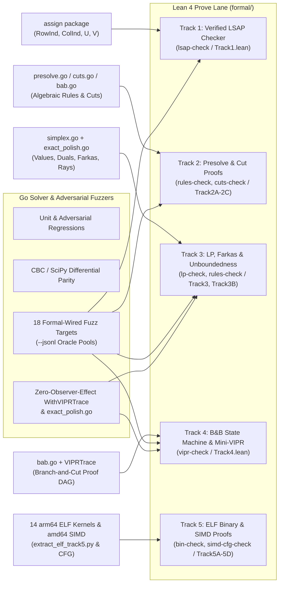

# Formal Verification Architecture (Lean 4 Prove Lane)

The `goblin` Lean 4 Prove Lane certifies solver outputs, proves the soundness of algebraic LP and MILP rules, and verifies compiled binary invariants for pure leaf helpers and SIMD kernels without lifting the Go runtime. Full-program verification of the Go solver, garbage-collected runtime, or floating-point Markowitz `LU` factorization ([`lu.go`](../lu.go)) remains out of scope. All proofs and standalone verifiers live in an isolated Lake workspace ([`formal/`](../formal/lakefile.toml)) pinned to Lean `v4.36.0` with zero external package dependencies, compiling across 72 Lake build jobs with zero warnings (`22` Lean files, `27,659` LOC: `15` library modules in `GoblinFormal` totaling `25,376` LOC and `7` CLI executables in `Apps/` totaling `2,283` LOC, paired with `21` formal and VIPR Go files totaling `24,656` LOC). Programmatic `Lean.collectAxioms` inspection across all `2,565` kernel-checked `TheoremInfo` declarations (`809` authored `theorem` and `lemma` declarations: `401` public and `408` private) and `124` `#guard_msgs in #print axioms` locks in [`AxiomAudit.lean`](../formal/GoblinFormal/AxiomAudit.lean) confirms `0` `sorryAx`, `0` `Lean.trustCompiler` or `Lean.ofReduceBool`, and `0` custom axioms.

---

## 1. Architectural Decision and Boundaries

The `goblin` solver maintains a four-part empirical verification suite: unit and regression tests, differential parity against COIN-OR CBC and SciPy, targeted fuzzers (`fuzz_test.go`, `mad_fuzz_test.go`, `assign/fuzz_test.go`), and scalar-vs-SIMD parity tests. The Lean 4 Prove Lane closes three gaps that empirical testing cannot eliminate:

1. **Result soundness**: machine-checked proofs show that concrete primal/dual outputs, exact rational basis duals, Meyer recession rays, and branch-and-cut proof traces from `goblin` or `goblin/assign` establish global optimality, valid bounds, unboundedness, or infeasibility independent of bugs in the Go solver or SIMD kernels.
2. **Rule soundness**: machine-checked proofs show that algebraic cuts, presolve tightenings, Euclidean GCD reductions, LP postsolve dual reconstructions, symmetry breaking, and branch-and-bound pruning rules preserve feasible solutions and valid dual bounds.
3. **Compiled-binary and SIMD leaf assurance**: machine-checked proofs directly over `14` stock compiled `arm64` ELF routines, disassembled `amd64` SIMD control-flow graphs, and IEEE-754 vector lane reductions verify pure leaf equivalence, zero heap allocation, panic-bounds unreachability, `VZEROUPPER`/EVEX ABI invariants, and tree-reduction parity.



### Rejected Approaches

We explicitly reject three verification patterns for `goblin`:

- **Direct Go-to-Lean source lifting**: Tools such as Aeneas succeed on Rust because the borrow checker eliminates pointer aliasing and exposes pure functional semantics. Go lacks an ownership type system and a mature Lean source-extraction pipeline; hand-translating imperative Go into Lean creates an unverified translation gap.
- **Full-program binary verification across the Go GC and runtime**: No published work verifies Go's concurrent tri-color mark-and-sweep garbage collector (`runtime.mallocgc`, `runtime.gcWriteBarrier*`) or goroutine scheduler at the machine-code level. State-of-the-art verified GCs (CakeML in HOL4, CertiCoq via CompCert) verify bespoke, single-threaded copying or mark-and-sweep collectors built inside a proof assistant from scratch. Empirical disassembly (`go tool objdump`) of `goblin` confirms that allocating routines such as `verifyExactRationalFarkas` (2,759 instructions) invoke `runtime.makeslice`, `runtime.growslice`, `runtime.mallocgc*`, and `runtime.gcWriteBarrier2`/`3`, which pulls the entire Go runtime into the proof. Binary verification in `goblin` therefore targets only **zero-allocation, GC-free paths** (Track 5), which cover core hot loops thanks to `goblin`'s pre-allocated `Workspace` architecture.
- **Floating-point proof of numerical linear algebra**: Proving IEEE-754 rounding bounds for Markowitz pivoting and Forrest-Tomlin `U` updates ([`lu.go`](../lu.go)) carries extreme proof cost for low defect yield. A posteriori certificate checking verifies solver outputs directly without trusting those internals.
- **Complementary Go-native verifiers (outside Lean)**: If source-level panic-freedom and slice-bounds proofs over allocating Go code are ever needed without Lean ISA models, **Gobra** (ETH Zurich, Viper/SMT) and **Goose/Perennial** (Rocq/Coq) are the established Go-native options. They target Go source rather than compiled binaries and do not replace Lean 4's mathematical certification libraries.

---

## 2. Industry Precedents and Anti-Translation-Gap Rules

The Prove Lane adopts patterns validated by production and research Lean 4 verification systems (2024 to 2026):

| Precedent | Domain | Architecture | Adopted Rule for `goblin` |
| :--- | :--- | :--- | :--- |
| **Google DeepMind AlphaProof Code (`google-deepmind/code-verification`)** | Production cryptographic library (`libsignal`, compiled AArch64 binaries) | Verified unmodified compiled AArch64 Linux machine code directly against open-source Lean 4 AArch64 semantics (`arm64-semantics/`, `ElfRunsTo`, ~6.5M lines of proofs covering ~140k instructions) | Proves that Lean 4 binary verification works on stock compiled ELF code; Track 5 models AArch64 instruction semantics directly in `Track5A.lean`, `Track5B.lean`, and `Track5D.lean` |
| **Anthropic + Theorem (123 OSS-Fuzz libraries)** | Production C/C++ binaries (static single-threaded RISC-V `musl` ELF) | Verified 239 fuzz entry points in Rocq (~180M lines) for bounded crash-freedom (< 64 MB inputs) using Theorem's Linux Process Semantics | Highlights the domain contrast: C/C++ needs crash-freedom proofs, whereas Go already enforces memory safety at runtime; `goblin`'s primary risk is mathematical/optimality soundness (Tracks 1 to 4) |
| **Anthropic FlashProve** (*Provable Inference for LLMs*) | Cryptographic inference verification | Fast C++ execution engine paired with a Lean-verified checker and short, human-auditable top-level theorems | Keep top-level optimality and soundness theorem statements concise and auditable; keep execution speed in Go |
| **`leanprover/lp-verify`, LeanSAT (`bv_decide`), & LeanVIPR** | LP, SAT/Bitvectors, and MILP certification | Untrusted external solver emits a mathematical certificate (dual multipliers, Farkas ray, LRAT, or VIPR trace); pure-Lean checker validates it inside the kernel | Prefer certificate checking wherever `goblin` emits witnesses (`U`/`V` in `assign`, `Duals`/`Farkas`/`UnboundedCertificate` in `simplex.go` and `exact_polish.go`, `VIPRTrace` in `vipr_trace.go`) |
| **AWS Cedar (`cedar-spec`) & Belay (SQLite)** | Cloud authorization (Rust) and SQLite queries/migrations | Small executable Lean 4 semantic specification + formal proofs + high-volume differential testing against the shipping engine | Pair every rule-level Lean model with automated Go-vs-Lean differential fuzzing so implementations cannot drift |
| **`lean-zip` (zlib), `nasa-jpl/L4YAML`, & `conao3/lean-py`** | Compression, YAML 1.2.2 parsing, Python-Lean bridges | Verified Lean 4 kernel compiled natively and invoked through thin host adapters or CLI boundaries | Compile Lean checkers to standalone executables via `lake build`; keep `go test ./...` free of Lean toolchain dependencies |
| **Certora (`zlib` `inflate_table`) & `zksecurity/leanPython`** | Legacy C and Python 3.12 in Lean | Targeted C-to-Lean lifting and unverified Lean re-implementations | Do not confuse writing Lean code with formal verification; every Prove Lane file proves its target invariant with zero `sorry` |

### Three Non-Negotiable Integrity Rules

1. **Zero translation gap via certificates or binary proofs**: Whenever `goblin` emits a witness, the standalone Lean executable checks the output of the actual Go binary inside a kernel-verified checker (Tracks 1, 3, and 4). Where a witness is unavailable on a small, pure leaf routine or zero-alloc kernel, Track 5 verifies the compiled machine code directly against a formal ISA or CFG model, and [`scripts/extract_elf_track5.py`](../scripts/extract_elf_track5.py) cross-checks every embedded opcode word and relocation target against fresh `GOARCH=arm64` ELF builds.
2. **Differential closure for rule specs**: Whenever a theorem covers an internal algorithm (such as GCD row reduction, presolve tightening, LP postsolve dual reconstruction, or lifted cover, lot-sizing, and multi-row cMIR cuts in Tracks 2 and 3B), the Lean specification runs as an executable function under `GOBLIN_FORMAL=1` differential tests and persistent `--jsonl` fuzzer pools against live `goblin` routines.
3. **Programmatic axiom audit**: Every proven declaration across all `2,565` kernel `TheoremInfo` entries relies strictly on `{propext, Classical.choice, Quot.sound}` plus kernel-checked `._native.bv_decide.ax_*` LRAT reflection axioms confined to `Track5A` (`14`), `Track5B` (`17`), and `Track5D` (`44`). The module [`AxiomAudit.lean`](../formal/GoblinFormal/AxiomAudit.lean) enforces `124` `#guard_msgs in #print axioms` locks on every `lake build`.

---

## 3. Implemented Prove Lane Architecture

All Lean 4 proof artifacts live in the isolated Lake workspace ([`formal/`](../formal/GoblinFormal.lean)) so default Go builds and `CGO_ENABLED=0` binaries require zero Lean toolchain dependencies. On the Go side, [`exact_polish.go`](../exact_polish.go) (`2,255` LOC) and [`vipr_trace.go`](../vipr_trace.go) (`4,738` LOC) implement exact `*big.Rat` basis polishing, LP/MILP unboundedness extraction, and opt-in `WithVIPRTrace` proof recording in pure standard-library Go with zero hot-path overhead when disabled, while `19` formal and VIPR test files (`17,291` LOC) house subprocess pools and differential bridges gated by `GOBLIN_FORMAL=1`.

### Workspace Foundation and Common Library

- **Toolchain & Lake Configuration**: [`formal/lean-toolchain`](../formal/lean-toolchain) pins `leanprover/lean4:v4.36.0`. [`formal/lakefile.toml`](../formal/lakefile.toml) declares zero external Lake dependencies, builds the 15-file `GoblinFormal` library, and compiles 7 standalone CLI executables in 72 Lake build jobs.
- **Common Arithmetic & Float64 Conversion** ([`Common/Basic.lean`](../formal/GoblinFormal/Common/Basic.lean)): Defines `finSum` over `Rat` and `intFinSum` over `Int` with proven linearity, injection-sum, and divisibility theorems (`finSum_inj_le`, `finSum_inj_eq`, `intFinSum_dvd`). Implements exact IEEE-754 binary64 bit-pattern conversion `float64BitsToRat` to dyadic `Rat` with `float64BitsToRat_isNone_iff` (rejecting Inf/NaN) and sign lemmas.
- **Pure `Init` JSON Parser** ([`Common/Json.lean`](../formal/GoblinFormal/Common/Json.lean)): Provides a total recursive-descent parser (`JsonVal`, `parseJson`) without importing the `Lean` compiler package, plus exact rational extractors (`asRat`, `asUInt64`, `getField`) supporting `{"num", "den"}` objects, `"num/den"` strings, and decimal numbers.

### Track 1: Verified LSAP Optimality Checker (`goblin/assign`)

- **Target surface**: `Result{RowInd, ColInd, Objective, U, V}` in [`assign/assign.go`](../assign/assign.go) and dual invariants in [`assign/solver.go`](../assign/solver.go) for both square ($m = n$) and rectangular ($m < n$ and $m > n$ via transposition) matrices.
- **Executable checker** ([`Track1.lean`](../formal/GoblinFormal/Track1.lean)): `checkLSAP` validates assignment injectivity, dual feasibility ($u_i + v_j \le C_{ij}$), rectangular dual invariants ($v_j \le 0$ and $v_j = 0$ on unassigned columns when $m < n$), and complementary slackness ($u_i + v_{p(i)} = C_{i, p(i)}$). The safe checker `checkLSAPSafe` computes `safeLowerBound` from `uSafe` when floating-point duals carry non-zero slack within tolerance `tol`.
- **Top-level theorems**: `dual_lower_bound`, `checkLSAP_sound`, and `checkLSAP_sound_max` prove global optimality over all injective assignments $q : \text{Fin } m \to \text{Fin } n$; `checkLSAPSafe_sound` and `checkLSAPSafe_sound_max` prove dual lower-bound and gap soundness.
- **CLI & Tests**: [`lsap-check`](../formal/Apps/LsapCheck.lean) supports single-file, `--jsonl`, and `--batch` verification across fixtures ([`lsap_sample.json`](../testdata/formal/lsap_sample.json), [`lsap_negative.json`](../testdata/formal/lsap_negative.json)), live scalar/SIMD solutions in [`assign/formal_lsap_test.go`](../assign/formal_lsap_test.go) (`TestFormalLSAPVerification`), and pooled fuzz bridges in [`assign/formal_fuzz_bridge_test.go`](../assign/formal_fuzz_bridge_test.go).

### Track 2: Soundness Proofs for MILP Presolve, Symmetry, and Cutting Planes

- **Track 2A (Presolve & Symmetry)** ([`Track2A.lean`](../formal/GoblinFormal/Track2A.lean), [`rules-check`](../formal/Apps/RulesCheck.lean)):
  1. **GCD Equality Infeasibility & `divCeil`** ([`bab.go`](../bab.go), `hasInfeasibleIntegerEqRow`, `divCeilInt64`): `divCeilSpec_spec` proves exact ceiling division across negative dividends; `gcd_row_infeasible_sound`, `gcd_row_infeasible_tol_sound`, and `hasInfeasibleIntEqSpec_sound` prove no integer vector satisfies $\text{lo} \le \sum_j a_j x_j \le \text{hi}$ when $g \mid a_j$ and $\lceil \text{lo} / g \rceil \cdot g > \text{hi}$.
  2. **Activity Tightening & Skipping** ([`presolve.go`](../presolve.go), `evalRowActivitySummary`, `residualQuotient`, `presolveCanSkipTerm`): `activity_implied_upper_sound` and `activity_implied_lower_sound` prove implied variable bounds; `presolveCanSkipTerm_sound` and `presolveCanSkipTerm_lower_sound` prove skip safety.
  3. **Binary Coefficient Strengthening** ([`presolve.go`](../presolve.go)): `binary_strengthen_pos_iff`, `binary_strengthen_pos_outward_sound`, and `binary_strengthen_neg_iff` prove equivalence and outward rounding soundness for binary coefficient tightening.
  4. **Orbital Symmetry Breaking** ([`presolve.go`](../presolve.go), `applyOrbitSymmetryBreaking`, `verifyOrbitSymmetry`, `detectDynamicNodeOrbit`): `orbit_automorphism_preserves_opt` and `monotone_orbit_order_sound` prove that ordering variables under a verified involution automorphism preserves optimal MILP objective values.
- **Track 2B (Core Cutting-Plane Soundness)** ([`Track2B.lean`](../formal/GoblinFormal/Track2B.lean), [`cuts-check`](../formal/Apps/CutsCheck.lean)):
  1. **GMI Tableau Cuts** ([`cuts.go`](../cuts.go), `separateGMICutsEx`): `gmi_cut_sound` and `gmi_weaken_upward_sound` prove validity for all feasible mixed-integer solutions with non-negative non-basic slacks.
  2. **Row Aggregation & Single-Row cMIR Cuts** ([`cuts.go`](../cuts.go), `separateCMIRFromSparseRow`, `mirUseLower`, `rowLegalMuSign`): `row_agg_legal_sound`, `row_agg_sum_sound`, and `row_agg_error_bound_sound` prove multiplier sign legality and aggregation error bounds; `mir_fundamental_ineq`, `mir_cut_sound`, `cmir_safe_rounded_sound`, and `cmir_complement_sound` prove complementation, MIR cut validity, and outward safe rounding.
  3. **VUB Disaggregation & Cut Cleanup** ([`cuts.go`](../cuts.go), `separateFlowAndVUBCuts`): `vub_disagg_sound`, `vub_disagg_opt_sound`, and `cut_drop_scale_sound` prove disaggregation validity and witness-bounded coefficient dropping/scaling soundness.
- **Track 2C (Universal Knapsack Cover, Lot-Sizing, Aggregated cMIR, & Cut-Drop Soundness)** ([`Track2C.lean`](../formal/GoblinFormal/Track2C.lean), [`cuts-check`](../formal/Apps/CutsCheck.lean)):
  1. **Lifted Minimal Knapsack Covers (`cover-check`)** ([`cuts.go`](../cuts.go), `separateCoverFromSparseRow`): `knapsack_cover_sound`, `lifted_knapsack_cover_sound`, and `checkKnapsackCoverCert_sound` prove validity across binary complementation, continuous/non-binary variable bound relaxation, minimal cover verification, and sequential DP up-lifting over all feasible mixed-integer solutions.
  2. **Lot-Sizing `(l, S)` Flow-Chain Cuts (`lotsizing-check`)** ([`cuts.go`](../cuts.go), `separateFlowAndVUBCuts`): `vub_zero_forces_prod_zero`, `lot_sizing_lS_sound`, and `checkLotSizingCutCert_sound` prove Barany-Van Roy-Wolsey flow-conservation suffix-sum inequalities across incoming inventory (`invIn`) and shared or duplicate binary setup columns (`binCol`).
  3. **Multi-Row Aggregated & Pairwise-Surrogate cMIR (`agg-cmir-check`)** ([`cuts.go`](../cuts.go), `separateAggregatedMIRCuts`, `separateCMIRFromSparseRow`): `row_agg_error_bound_opt_sound`, `agg_row_cmir_sound`, and `checkAggCMIRCert_sound` compose `row_agg_sum_sound` with `cmir_safe_rounded_sound` over unbounded and semi-bounded `Option Rat` domains with tightened integer bounds ($\lceil l \rceil$ and $\lfloor u \rfloor$).
  4. **Universal `finalizeSparseCut` Coefficient Drop & Scaling (`drop-check`)** ([`cuts.go`](../cuts.go), `finalizeSparseCut`, `finalizeCut`): `dropMinTerm_le`, `finalize_cut_drop_universal_sound`, and `checkFinalizedCutCert_sound` prove that dropping sparse terms with exact outward bound-extremum RHS compensation and positive scaling preserves cut validity universally over all feasible points.
- **Differential tests & white-box extractors**: [`formal_track2a_test.go`](../formal_track2a_test.go) (`TestFormalTrack2A`), [`formal_track2b_test.go`](../formal_track2b_test.go) (`TestFormalTrack2B`), [`formal_track2c_test.go`](../formal_track2c_test.go), [`formal_parallel_adversarial_test.go`](../formal_parallel_adversarial_test.go) (`TestFormalMultiFeatureCutAndOrbitStress`), and [`formal_export_test.go`](../formal_export_test.go) (`ExportPresolveRulesItems` with 256-row strided pagination and universal `ExportSeparatedCutsItems` without finite-box bailouts) cross-check Go routines against `rules-check` and `cuts-check`.

### Track 3: Verified LP Optimality, Farkas Infeasibility, Unboundedness, and Presolve Dual Postsolve

- **Target surface**: `Result.Values`, `Result.Duals`, and `Result.ReducedCosts` in [`solve.go`](../solve.go), `verifyUnscaledFarkas` and `verifyExactRationalFarkas` in [`simplex.go`](../simplex.go), `postsolveLP` and Euclidean GCD row reduction in [`presolve.go`](../presolve.go), and exact `*big.Rat` basis polishing and unboundedness extraction in [`exact_polish.go`](../exact_polish.go) (`ExactBasisDuals`, `ExactBasisSolution`, `ExactSafeDualBound`, `PolishExactBasisDuals`, `ExtractUnboundedCertificate`, `VerifyUnboundedCertificate`, `verifyExactUnboundedEdge`).
- **Track 3 Core LP & Farkas Checker** ([`Track3.lean`](../formal/GoblinFormal/Track3.lean), [`lp-check`](../formal/Apps/LpCheck.lean)): Supports `optimal`, `safe-bound`, and `farkas` modes in single-file, `--jsonl`, and `--batch` execution, parsing exact rational strings or raw IEEE-754 `float64` bit patterns via `float64BitsToRat`. Top-level theorems `checkPrimalFeasible_sound`, `safeDualBound_sound` (Neumaier-Shcherbina dual lower bound over `Rat`), `checkLPOptimal_sound`, and `checkFarkas_sound` establish certificate soundness, while `ExactBasisDuals` solves unscaled $B^\top y_{\min} = c_{\min,B}$ over `*big.Rat` via singleton peeling and partial-pivoting Gaussian elimination to certify free (`(-Inf, +Inf)`) and semi-bounded non-dyadic LPs at zero duality gap.
- **Track 3B Unboundedness, GCD Row Division, & LP Presolve Dual Postsolve** ([`Track3B.lean`](../formal/GoblinFormal/Track3B.lean), [`lp-check`](../formal/Apps/LpCheck.lean), [`rules-check`](../formal/Apps/RulesCheck.lean)):
  1. **LP & MILP Meyer Unboundedness (`lp-check` modes `unbounded` and `milp-unbounded`)**: `checkRecessionRay_sound`, `rayPoint_primalFeasible`, and `checkLPUnbounded_sound` verify a primal-feasible anchor $x_0$ and improving recession ray $d$, constructively proving that feasible points achieve arbitrarily negative objectives below any rational threshold $M$. For mixed-integer models, `ExtractUnboundedCertificate` scales rational recession rays by the LCM of integer-column denominators, and `checkIntegrality_sound`, `rayPoint_nat_integrality`, and `checkMILPUnbounded_sound` prove integer feasibility along $x_k = x_0 + k d$ for all $k \in \mathbb{N}$.
  2. **MIP Euclidean GCD Row Division (`rules-check` subcommand `gcd-div-check`)**: `gcd_row_div_sound` proves exact integer solution-set equivalence under $\lfloor \text{rhs} / d \rfloor$ (`<=`), $\lceil \text{rhs} / d \rceil$ (`>=`), and exact divisibility (`=`), plus infeasibility when $d \nmid \text{rhs}$ on equality rows.
  3. **LP Presolve & Postsolve Dual Reconstruction (`lp-check` mode `lp-presolve`)**: `lp_presolve_primal_lift`, `lp_presolve_safeDualBound_eq`, `lp_presolve_dual_bound_sound`, `lp_presolve_dual_sound`, and multi-step `lp_presolve_chain_dual_sound` prove exact primal lifting and the `Option Rat` identity `safeDualBound LP (postsolveLPDual LP LP' step yRed) = safeDualBound LP' yRed` across `fixedSubst`, `singletonRow`, `dualColFix`, `zeroObjEmptyColFix`, and `dropRedundantRow`.
- **Fixtures & Tests**: Verified on [`lp_optimal_sample.json`](../testdata/formal/lp_optimal_sample.json), [`lp_farkas_sample.json`](../testdata/formal/lp_farkas_sample.json), [`formal_track3_test.go`](../formal_track3_test.go), [`formal_track3b_test.go`](../formal_track3b_test.go), [`formal_parallel_adversarial_test.go`](../formal_parallel_adversarial_test.go) (`TestFormalUnboundedMeyerCliffs`), and `ExportLPCheckPayload` / `ExportUnboundedCheckPayload` in [`formal_export_test.go`](../formal_export_test.go).

### Track 4: Branch-and-Bound State Machine, Mini-VIPR, and Zero-Observer-Effect `VIPRTrace` (`bab.go`)

- **Global Bound State Machine** ([`Track4.lean`](../formal/GoblinFormal/Track4.lean)): Formalizes `BabState` (`openQueue`, `plungeNode`, `bestObjMin`, `prunedMinBound`, `unsolvedMinBound`, `isGapClosedSpec`) and proves invariant preservation (`ValidBabState`), global bound soundness (`bestBound_global_valid`, `infeasible_when_globalBound_none`), reduced-cost fixing (`rc_fixing_ub_sound`, `rc_fixing_lb_sound`, `rc_fixing_sound`, `dual_rc_bound_valid`, `stepReducedCostFix_valid`, `stepReducedCostFixInfeas_valid`), budget abort safety (`stepBudgetAbort_valid`), and optimality upon gap closure (`stepGapClosed_optimal`, `stepGapClosed_exact_optimal`) across all transition steps (`stepRoot_valid`, `stepSelectOpen_valid`, `stepTightenLowerBound_valid`, `stepFathomInfeas_valid`, `stepFathomBound_valid`, `stepBranchInt_valid`, `stepIncumbent_valid`).
- **Mini-VIPR Trace Verifier** ([`Track4.lean`](../formal/GoblinFormal/Track4.lean), [`vipr-check`](../formal/Apps/ViprCheck.lean)): Verifies rational MILP derivation DAGs (`conIndex`, `lincomb`, `roundUp`, `roundDown`, `assume`, `farkas`, `boundConflict`, `safeDual`, `dualBound`, `branch`) with strict assumption scoping across three `CertMode` variants (`infeasible`, `optimal`, and general `bound` with rational `targetLB` and optional `incumbent`). Top-level soundness theorems `checkMiniVIPR_sound`, `checkMiniVIPR_infeasible_sound`, `checkMiniVIPR_optimal_sound`, and `checkMiniVIPR_bound_sound` are locked in [`AxiomAudit.lean`](../formal/GoblinFormal/AxiomAudit.lean).
- **Zero-Observer-Effect `VIPRTrace` Export** ([`vipr_trace.go`](../vipr_trace.go), [`solve.go`](../solve.go), [`bab.go`](../bab.go)): Configuring `WithVIPRTrace(tr)` on `NewVIPRTrace()` records an exact `*big.Rat` proof DAG during single-threaded `BackendGo` Branch-and-Cut without disabling solver components:
  1. **Certified root and in-tree cutting planes**: `runRootCutLoop` and `tryInTreeCuts` remain active under tracing, certifying tableau Chvatal-Gomory cuts, Case 1 `lincomb` and Case 2 5-step binary `branch` VUB disaggregations, single-row CG/MIR cuts, and CG rank-1 lifted minimal knapsack covers through `verifyGlobalCutRat`.
  2. **Purged-cut index preservation**: `VIPRTrace` maintains append-only `allCuts` paired with synced `activeCutIDs` (`snapshotActiveCuts`, `restoreActiveCuts`, `addCertifiedCutPlanes`, `purgeSlackCuts`), active-cut-aware `solveBasisTransposeActive` / `extractNodeSafeDualActive` / `extractNodeFarkasActive` over sparse `[]viprRowMult` multipliers, and transitive `collectNeededCuts` emission in `finalize`.
  3. **Certified RCF & unbounded integer tightening**: Root RCF, in-tree RCF, and `tightenUnboundedIntCols` certify each bound tightening (`exactCutoffRat`, `bestDualForRCF`, `certifyAndApplyRCF`, `certifyPrunedChildForCutoff`, `certifyAndApplyUnboundedIntTightening`) via `StepRule.branch` plus `safeDual`, `boundConflict`, or `farkas` on the pruned child while skipping only individual uncertifiable candidates.
  4. **Arbitrary-precision split bounds & raised caps**: Branching and strong branching encode arbitrary-precision `*big.Int` split bounds (`viprFloorBigInt`, `viprCeilBigInt`) as raw JSON integer tokens under raised bailout caps (`viprMaxPropRowLen = 512`, `viprMaxRatDenomBits = 2048`, `viprMaxNucleusSize = 1024`), alongside LCM-cleared GCD infeasibility proofs (`buildGCDInfeasSteps`) and cut-free singleton-integer leaf resolution (`resolveFixedIntLeaf`).
- **Fixtures & Tests**: Verified on [`vipr_sample.json`](../testdata/formal/vipr_sample.json), [`formal_track4_test.go`](../formal_track4_test.go), [`formal_oracle_pool_test.go`](../formal_oracle_pool_test.go) (`TestFormalVIPRBoundMode`), [`formal_parallel_adversarial_test.go`](../formal_parallel_adversarial_test.go) (`TestFormalParallelBoundAndOptimumInvariants`), and live Branch-and-Cut traces in [`vipr_trace_test.go`](../vipr_trace_test.go) (`TestVIPRTrace`, `TestVIPRTraceRootCutsVUBAndCover`, `TestVIPRTraceInTreeCutsAndPurge`, `TestVIPRTraceReducedCostFixingAndUnboundedInt`, `TestVIPRTraceRaisedCapsAndLargeSplitBounds`).

### Track 5: Direct Binary Verification of Zero-Alloc Go Kernels and SIMD Equivalence

- **Automated `GOARCH=arm64` ELF Extractor** ([`scripts/extract_elf_track5.py`](../scripts/extract_elf_track5.py)): Portable Python 3 CLI that compiles `CGO_ENABLED=0 GOOS=linux GOARCH=arm64` binaries (`-gcflags=-l` and default optimizations), parses ELF64 `.symtab`/`.text` against `go tool objdump -s` 32-bit `UInt32` opcode streams and `B`/`BL` relocation targets, and verifies (`--verify`) or emits (`--emit`) all `14` verified `arm64` routines across `Track5A` (`4`), `Track5B` (`5`), and `Track5D` (`5`).
- **Tier 5A (ARM64 Pure Leaf Equivalence)** ([`Track5A.lean`](../formal/GoblinFormal/Track5A.lean)): Implements a stock `GOARCH=arm64` ELF instruction decoder and operational semantics (`Arm64State`, `runArm64`). Proves bit-exact register/memory equivalence across `4` compiled Go 1.27 leaf helpers (`splitmix64_arm64_equiv`, `canonicalFloatBitsInlined_arm64_equiv`, `canonicalFloatBits_arm64_equiv`, `divCeilInt64_arm64_equiv`, `gcdInt64_arm64_equiv`).
- **Tier 5B (Zero-Alloc Solver Kernels)** ([`Track5B.lean`](../formal/GoblinFormal/Track5B.lean), [`bin-check`](../formal/Apps/BinCheck.lean)): Verifies `5` compiled Go 1.27 `arm64` solver routines (`hasInfeasibleIntegerEqRow`, `assign.augmentRowScalar`, `internal/simd.InitReducedRow64`, `assign.refillQueueIndirectScalar`, `assign.relaxRowIndirectScalar`). Proves zero heap allocation/GC write barriers (`checkZeroGC_run_sound`), stack-headroom soundness (`checkStackGuard_sound`), `runtime.panicBounds` unreachability (`checkPanicBoundsReachability_run_safe`), ELF safety (`hasInfeasibleIntegerEqRow_elf_safe`, `augmentRowScalar_elf_safe`, `augmentRowScalar_done_nil_no_selectnbrecv`), and concrete overlay executions (`hasInfeasibleIntegerEqRow_infeasible_gcd_exec`, `hasInfeasibleIntegerEqRow_feasible_gcd_exec`, `augmentRowScalar_concrete_exec`).
- **Tier 5C (amd64 SIMD ISA and CFG Safety)** ([`Track5C.lean`](../formal/GoblinFormal/Track5C.lean), [`simd-cfg-check`](../formal/Apps/SimdCfgCheck.lean)): Mirrors [`cmd/goblin-optcheck/main.go`](../cmd/goblin-optcheck/main.go) vector disassembly checks over inductive CFG operational semantics. The soundness theorem `checkVectorCFG_sound` proves that every reachable legacy SSE transition, `RET`, `CALL`, and external tail jump starts with clean upper YMM/ZMM bits (`VZEROUPPER`), and that non-AVX-512 functions contain zero reachable EVEX instructions (`50/1742` vector/ABI routines verified in live `goblin` binaries).
- **Tier 5D (LSAP Cancellation ELF Proofs & IEEE-754 SIMD `Min2`/Lane Equivalence)** ([`Track5D.lean`](../formal/GoblinFormal/Track5D.lean), [`formal_track5d_test.go`](../formal_track5d_test.go)):
  1. **LSAP `TwoSum`, `exactReducedCost`, & Kahn DAG ELF Safety (`5` routines)**: Extends `Track5A` scalar FP semantics (`Arm64InsnD`, `stepArm64D_proxy_status_pc`) for `FMADDD` and `FMOVD $imm8`, proving `twoSumAssign_arm64_equiv`, `checkFramelessLeaf_run_sound`, `exactReducedCost_and_leaves_elf_safe`, `exactReducedCostNoinline_elf_safe`, `hasPotentialCancellation_elf_safe` (1,353 instructions, zero GC calls, 832-byte stack headroom, and 56 guarded `runtime.panicBounds` branches), and `hasPotentialCancellation_exactD_zeroGC_and_pb` across `assign.twoSumAssign`, `assign.clampFinite`, `-gcflags=-l` and frameless `assign.exactReducedCost`, and `assign.hasPotentialCancellation`.
  2. **Functional IEEE-754 SIMD Lane & `Min2` Tree-Reduction Equivalence**: Models `BitVec 64` sign-magnitude `totalOrder` (`f64TotalKey`) and IEEE-754 numeric ordering (`f64NumKey`, `canonZero64`, `vminpdLane`), bridging `f64Lt` to `Track5A.f64Cmp` (`f64Lt_eq_f64Cmp_n`) and proving `signed_zero_and_subnormal_audit`, `vminpdLane_signed_zero_asymmetry`, `vminpdLane_numKey_assoc_comm`, `mergeMin2` commutativity/associativity (`insertEntry_comm`, `insertEntry_dropThird`, `mergeMin2_insert`), 4-lane AVX2 and 8-lane AVX-512 tree-reduction equivalence to sequential `scalarMin2Fold` (`simdTree4Reduce_eq_scalarMin2Fold`, `simdTree8Reduce_eq_scalarMin2Fold`), witness/minimality soundness (`scalarMin2Fold_witness_and_minimality`), and `GreaterEqual` filter soundness (`min2FilteredStep_eq_scalarMin2Step`).
- **ELF & CFG Differential Tests**: [`formal_track5_test.go`](../formal_track5_test.go) and [`formal_track5d_test.go`](../formal_track5d_test.go) validate live `arm64` ELF and `amd64` SIMD kernels plus adversarial negative controls (`Neg_InjectedMallocgc`, `Neg_UnguardedPanicBounds`, `Neg_CorruptedImmediate`, `Neg_DirtyRet`, `Neg_DirtyCall`, `Neg_LegacySSEWhileDirty`, `Neg_UnguardedEVEX`).

### Summary Matrix of Modules, Declarations, Executables, and Theorems

| Component | Module / App | Decls (`Auth / Pub / Kernel`, Locks) | Key Top-Level Theorems | Go Test & Oracle Harness |
| :--- | :--- | :--- | :--- | :--- |
| **Common** | [`Common/Basic.lean`](../formal/GoblinFormal/Common/Basic.lean), [`Common/Json.lean`](../formal/GoblinFormal/Common/Json.lean) | `49 / 42 / 212` (`4`) | `finSum_inj_le`, `finSum_inj_eq`, `intFinSum_dvd`, `float64BitsToRat_isNone_iff` | [`formal_common_test.go`](../formal_common_test.go), [`formal_oracle_pool_test.go`](../formal_oracle_pool_test.go) |
| **Track 1 (LSAP)** | [`Track1.lean`](../formal/GoblinFormal/Track1.lean), `lsap-check` | `18 / 15 / 46` (`5`) | `dual_lower_bound`, `checkLSAP_sound`, `checkLSAP_sound_max`, `checkLSAPSafe_sound`, `checkLSAPSafe_sound_max` | [`assign/formal_lsap_test.go`](../assign/formal_lsap_test.go), [`assign/formal_fuzz_bridge_test.go`](../assign/formal_fuzz_bridge_test.go), [`assign/formal_adversarial_regression_test.go`](../assign/formal_adversarial_regression_test.go) |
| **Track 2A (Presolve)** | [`Track2A.lean`](../formal/GoblinFormal/Track2A.lean), `rules-check` | `50 / 35 / 125` (`13`) | `divCeilSpec_spec`, `gcd_row_infeasible_sound`, `hasInfeasibleIntEqSpec_sound`, `activity_implied_upper_sound`, `presolveCanSkipTerm_sound`, `binary_strengthen_pos_outward_sound`, `orbit_automorphism_preserves_opt` | [`formal_track2a_test.go`](../formal_track2a_test.go), [`formal_export_test.go`](../formal_export_test.go), [`formal_adversarial_regression_test.go`](../formal_adversarial_regression_test.go) |
| **Track 2B (Core Cuts)** | [`Track2B.lean`](../formal/GoblinFormal/Track2B.lean), `cuts-check` | `59 / 16 / 83` (`12`) | `gmi_cut_sound`, `gmi_weaken_upward_sound`, `row_agg_legal_sound`, `mir_cut_sound`, `cmir_safe_rounded_sound`, `cmir_complement_sound`, `vub_disagg_sound` | [`formal_track2b_test.go`](../formal_track2b_test.go), [`formal_export_test.go`](../formal_export_test.go), [`formal_adversarial_regression_test.go`](../formal_adversarial_regression_test.go) |
| **Track 2C (Adv. Cuts)** | [`Track2C.lean`](../formal/GoblinFormal/Track2C.lean), `cuts-check` (`cover-check`, `lotsizing-check`, `agg-cmir-check`, `drop-check`) | `55 / 21 / 185` (`12`) | `lifted_knapsack_cover_sound`, `checkKnapsackCoverCert_sound`, `lot_sizing_lS_sound`, `checkLotSizingCutCert_sound`, `agg_row_cmir_sound`, `checkAggCMIRCert_sound`, `finalize_cut_drop_universal_sound`, `checkFinalizedCutCert_sound` | [`formal_track2c_test.go`](../formal_track2c_test.go), [`formal_export_test.go`](../formal_export_test.go), [`formal_parallel_adversarial_test.go`](../formal_parallel_adversarial_test.go) |
| **Track 3 (LP/Farkas)** | [`Track3.lean`](../formal/GoblinFormal/Track3.lean), `lp-check` | `21 / 10 / 75` (`4`) | `checkPrimalFeasible_sound`, `safeDualBound_sound`, `checkLPOptimal_sound`, `checkFarkas_sound` | [`formal_track3_test.go`](../formal_track3_test.go), [`formal_fuzz_bridge_test.go`](../formal_fuzz_bridge_test.go), [`formal_adversarial_regression_test.go`](../formal_adversarial_regression_test.go) |
| **Track 3B (Rays/Postsolve)** | [`Track3B.lean`](../formal/GoblinFormal/Track3B.lean), `lp-check` (`unbounded`, `milp-unbounded`, `lp-presolve`), `rules-check` (`gcd-div-check`) | `89 / 25 / 213` (`12`) | `checkLPUnbounded_sound`, `checkMILPUnbounded_sound`, `gcd_row_div_sound`, `lp_presolve_primal_lift`, `lp_presolve_safeDualBound_eq`, `lp_presolve_dual_sound`, `lp_presolve_chain_dual_sound` | [`formal_track3b_test.go`](../formal_track3b_test.go), [`exact_polish.go`](../exact_polish.go), [`formal_export_test.go`](../formal_export_test.go), [`formal_parallel_adversarial_test.go`](../formal_parallel_adversarial_test.go) |
| **Track 4 (B&B/VIPR)** | [`Track4.lean`](../formal/GoblinFormal/Track4.lean), `vipr-check` | `112 / 73 / 364` (`22`) | `bestBound_global_valid`, `rc_fixing_sound`, `stepGapClosed_optimal`, `checkMiniVIPR_sound`, `checkMiniVIPR_infeasible_sound`, `checkMiniVIPR_optimal_sound`, `checkMiniVIPR_bound_sound` | [`formal_track4_test.go`](../formal_track4_test.go), [`vipr_trace.go`](../vipr_trace.go), [`vipr_trace_test.go`](../vipr_trace_test.go), [`formal_parallel_adversarial_test.go`](../formal_parallel_adversarial_test.go) |
| **Track 5A (ARM64 Leaf)** | [`Track5A.lean`](../formal/GoblinFormal/Track5A.lean), `bin-check` | `98 / 80 / 561` (`5`) | `splitmix64_arm64_equiv`, `canonicalFloatBits_arm64_equiv`, `divCeilInt64_arm64_equiv`, `gcdInt64_arm64_equiv` | [`formal_track5_test.go`](../formal_track5_test.go), [`scripts/extract_elf_track5.py`](../scripts/extract_elf_track5.py) |
| **Track 5B (ARM64 Kernel)** | [`Track5B.lean`](../formal/GoblinFormal/Track5B.lean), `bin-check` | `140 / 40 / 334` (`9`) | `checkZeroGC_run_sound`, `checkStackGuard_sound`, `checkPanicBoundsReachability_run_safe`, `hasInfeasibleIntegerEqRow_elf_safe`, `augmentRowScalar_elf_safe` | [`formal_track5_test.go`](../formal_track5_test.go), [`scripts/extract_elf_track5.py`](../scripts/extract_elf_track5.py) |
| **Track 5C (SIMD CFG)** | [`Track5C.lean`](../formal/GoblinFormal/Track5C.lean), `simd-cfg-check` | `14 / 1 / 129` (`1`) | `checkVectorCFG_sound` | [`formal_track5_test.go`](../formal_track5_test.go) |
| **Track 5D (LSAP ELF/SIMD)** | [`Track5D.lean`](../formal/GoblinFormal/Track5D.lean) | `104 / 43 / 238` (`25`) | `twoSumAssign_arm64_equiv`, `exactReducedCost_and_leaves_elf_safe`, `hasPotentialCancellation_elf_safe`, `vminpdLane_signed_zero_asymmetry`, `simdTree4Reduce_eq_scalarMin2Fold`, `simdTree8Reduce_eq_scalarMin2Fold`, `scalarMin2Fold_witness_and_minimality` | [`formal_track5d_test.go`](../formal_track5d_test.go), [`scripts/extract_elf_track5.py`](../scripts/extract_elf_track5.py), [`internal/simd/assign_test.go`](../internal/simd/assign_test.go) |
| **Total / Axiom Lock** | [`AxiomAudit.lean`](../formal/GoblinFormal/AxiomAudit.lean) (`22` Lean files, `27,659` LOC) | **`809 / 401 / 2,565` (`124`)** | `124` `#guard_msgs in #print axioms` locks; `0` `sorryAx`, `0` `Lean.trustCompiler`, `0` custom axioms | Enforced by `lake build --wfail` (`72/72` jobs) |

---

## 4. Streaming Batch Oracles, Formal Fuzzing, and Soundness Bug Ledger

Spawning a fresh Lean process per test case caps differential throughput at roughly 10 to 30 checks per second. To sustain thousands of formal checks per second inside parallel Go fuzzers without temporary files, the Prove Lane pairs streaming CLI modes with persistent worker pools.

### Streaming `--jsonl` and `--batch` Modes with Persistent Go Worker Pools

- **Checker CLI & Subcommand Modes**: All five mathematical verifiers ([`lsap-check`](../formal/Apps/LsapCheck.lean), [`lp-check`](../formal/Apps/LpCheck.lean), [`cuts-check`](../formal/Apps/CutsCheck.lean), [`rules-check`](../formal/Apps/RulesCheck.lean), and [`vipr-check`](../formal/Apps/ViprCheck.lean)), including all eight Wave 3 subcommands (`cover-check`, `lotsizing-check`, `agg-cmir-check`, `drop-check` on `cuts-check`; `gcd-div-check` on `rules-check`; `unbounded`, `milp-unbounded`, `lp-presolve` on `lp-check`), support `--jsonl` line-delimited streaming over `stdin`/`stdout` and `--batch <path | ->` JSON array verification while preserving single-file CLI compatibility. In `--jsonl` mode, each line carries per-request `mode`, `subcommand`/`op`, or `tol` fields, flushes a single-line JSON response (`ok`, `detail` or `error`, optional rational `bound` or `result`), and continues across rejected certificates until `EOF`.
- **Bounded Persistent Worker Pools**: In [`formal_oracle_pool_test.go`](../formal_oracle_pool_test.go), `CallFormalOracleJSONL`, `CallFormalOracleSubcmdJSONL`, `FormalOracleCall`, `FormalOracleBatch`, and per-CLI wrappers (`FormalCheckLPJSONL`, `FormalCheckCutsJSONL`, `FormalCheckRulesJSONL`, `FormalCheckVIPRJSONL`, `FormalCheckLSAPJSONL`) manage up to 4 persistent `--jsonl` child processes per binary/subcommand behind channel semaphores (`64` KiB buffered writers, `32` MiB max scanner tokens, automatic multi-line JSON compaction, and single broken-pipe auto-respawn). When `FormalOracleEnabled()` (`GOBLIN_FORMAL=1`) is unset, zero Lean child processes spawn.
- **External Test & White-Box Bridges**: [`formal_fuzz_bridge_test.go`](../formal_fuzz_bridge_test.go) exposes these pooled callers to `package goblin_test`, [`assign/formal_fuzz_bridge_test.go`](../assign/formal_fuzz_bridge_test.go) maintains an independent 4-worker `lsap-check --jsonl` pool with exact IEEE-754 bit-pattern encoding (`buildFormalLSAPJSON`) for `package assign_test`, and [`formal_export_test.go`](../formal_export_test.go) exports white-box LP/unboundedness, presolve-rule, and universal separated-cut payloads (`ExportLPCheckPayload`, `ExportUnboundedCheckPayload`, `ExportPresolveRulesItems`, `ExportSeparatedCutsItems`, tested end-to-end in `TestFormalWave2SubcommandsAndExporters`).

### Fuzzer Batch-Oracle Wiring

All 18 shipping solver fuzz targets connect directly to the pooled `--jsonl` Lean verifiers whenever `GOBLIN_FORMAL=1` is active:

- **LP & MILP Fuzzers** ([`fuzz_test.go`](../fuzz_test.go), [`mad_fuzz_test.go`](../mad_fuzz_test.go), [`mad_crafted_fuzz_test.go`](../mad_crafted_fuzz_test.go)): The fuzzers `FuzzLPSolver` and `FuzzLPSmall` validate scalar, SIMD, polished, unbounded, and presolved/postsolved LP certificates via `lp-check --jsonl`. Meanwhile, `FuzzMILPSolver`, `FuzzMIPSmall`, and the four MAD fuzzers (`FuzzMADMediumDecomposed`, `FuzzMADExactOptimum`, `FuzzMADAdversarialRegimes`, `FuzzMADMetamorphicAndLimits`) cross-check presolve and GCD rules via `rules-check --jsonl`, root LP bounds via `lp-check --jsonl`, universal separated cuts via `cuts-check --jsonl`, and full-feature (`Presolve+Cuts+Heuristics+Workers`) vs. zero-observer-effect `WithVIPRTrace` (`Cuts+RCF`) Branch-and-Cut certificates via `vipr-check --jsonl` (`assertFullFeatureVsVIPR`).
- **Assignment Fuzzers** ([`assign/fuzz_test.go`](../assign/fuzz_test.go), [`assign/crafted_fuzz_test.go`](../assign/crafted_fuzz_test.go)): `FuzzLinearSum` and the seven crafted LSAP fuzzers validate exact dyadic optimality (`mode: "exact"`, `tol: 0`) and scale-aware safe dual bounds (`mode: "safe"`) via `lsap-check --jsonl`.
- **Dedicated Adversarial Formal Targets**: Three targeted generators stress floating-point boundary regimes directly against the Lean kernel: `FuzzAdversarialLPFormal` (multi-singleton postsolve chains, free non-dyadic LPs, and box-bounded ill-conditioned matrices), `FuzzAdversarialMIPFormal` (mixed-scale activity tightening, dynamic orbital rounding, large-GCD integer equalities, cMIR underflow, non-dyadic VUBs, `ObjConstant` gap shifts, Ruiz subnormal scaling, and dual-amplified slacks), and `FuzzAssignAdversarialFormal` (near-rank-one ULP drift and `1e-320` to `1e305` exponent spreads).
- **Automated Runners**: Step `5/5` of [`scripts/verify_formal.sh`](../scripts/verify_formal.sh) runs all 19 `^Fuzz` seed corpora (`18` formal-wired solver targets plus `FuzzPuLPJSON`) under `GOEXPERIMENT=simd GOBLIN_FORMAL=1`, while [`scripts/local_fuzz_soak.sh`](../scripts/local_fuzz_soak.sh) supports `--formal` (`--phase=assign|mad|all`) for sustained parallel fuzz soaks.

### Complete Adversarial Soundness Bug Ledger

Combining formal Lean proof audits, red-team adversarial suites, and live `--jsonl` fuzzer campaigns uncovered and remediated 14 numbered solver soundness defects (`Bugs #1-#14`), 5 cutting-plane rounding defects (`Bugs A-E`), 3 presolve/postsolve/wrapper edge defects, and 2 SIMD bit-parity discrepancies, all locked with deterministic regressions in [`formal_adversarial_regression_test.go`](../formal_adversarial_regression_test.go), [`assign/formal_adversarial_regression_test.go`](../assign/formal_adversarial_regression_test.go), [`formal_parallel_adversarial_test.go`](../formal_parallel_adversarial_test.go), [`formal_track2c_test.go`](../formal_track2c_test.go), [`formal_track3b_test.go`](../formal_track3b_test.go), and [`formal_track5d_test.go`](../formal_track5d_test.go):

| Defect | Solver Surface | Root Cause & Lean Oracle Catch | Remediation & Regression Lock |
| :--- | :--- | :--- | :--- |
| **Bug #1 + Subnormal Margin** | [`presolve.go`](../presolve.go) (`runActivityTighteningDirty`, `handleExtremeRowTightening`, `evalRowActivityWide`) | MIP row-redundancy checks accepted `-1e-9` tolerance, deleting active tiny-coefficient rows (`1e-9 * x <= 0`); wide subnormal activity underflowed `0x1p-50 * |val|` to `0`. Rejected by `rules-check` and `vipr-check`. | Enforced non-negative redundancy margins and outward subnormal rounding; locked in `TestFormalAdversarialBug1PresolveTinyCoeffRedundancy`. |
| **Bug #2 (Dynamic Orbit Rounding)** | [`presolve.go`](../presolve.go), [`heuristics.go`](../heuristics.go) (`detectDynamicNodeOrbit`, `evalFixedRowResidual`) | Depth-1+ dynamic symmetry rounded `rhs - sum a_j x_j` to `float64` (`2^53 - 0.25 == 2^53`), hashing asymmetric groups into one orbit and returning false `StatusInfeasible`. Rejected by `rules-check` (`orbit-check`) and `vipr-check`. | Added exact `evalFixedRowResidualExact` with `*big.Rat` fallback; locked in `TestFormalAdversarialBug2DynamicOrbitRounding`. |
| **Bug #3 (`ObjConstant` Gap Shift)** | [`bab.go`](../bab.go), [`heuristics.go`](../heuristics.go) (`isGapClosed`, `searchShift`) | Folding `ObjConstant` into `bestObjMin` before `isGapClosed` violated linear `RelGapTol` (`1e12`) and caused suboptimal `StatusOptimal` under `1e17` cancellation at zero tolerances. Rejected by `vipr-check`. | Added `searchShift` linear-frame gap evaluation across B&B, cutoffs, and heuristics; locked in `TestFormalAdversarialBug3ObjConstantGapAndCancellation`. |
| **Bug #4 + VUB Outward Rounding** | [`cuts.go`](../cuts.go) (`separateCMIRFromSparseRow`, `buildCutStaticCache`) | Signed IEEE-754 underflow (`num / delta == -0.0`) skipped `nextDown(alpha)`, near-zero negative `alpha` misrounded `fj` near `1`, `nextUp(-Inf)` / `nextDown(+Inf)` returned `+-MaxFloat64`, and non-dyadic VUB `capVal / ak` rounded down. Rejected by `cuts-check`. | Guarded signed-zero underflow, fractional `fj`, and non-finite inputs, and applied `nextUp(capVal / ak)`; locked in `TestFormalAdversarialBug4CMIRUnderflowAndVUBRounding`. |
| **Bug #5 (LSAP Stage 1 ULP Drift)** | [`assign/solver.go`](../assign/solver.go) (`hasPotentialCancellation`, `polishStage2Duals`) | Near-rank-one matrices (`A[i] + B[j] + k * ulp`) bypassed `hasPotentialCancellation` without checking unmatched cells, skipping Stage 2 refinement and returning suboptimal matchings. Rejected by `lsap-check` (`tol = 0`). | Added 4-TwoSum `exactReducedCost`, zero-alloc Kahn DAG tight-edge acyclicity check, and exact dual polishing; locked in `TestFormalAdversarialBug5NearRankOneULPDrift`. |
| **Bug #6 (LP Slack Singleton Dual)** | [`presolve.go`](../presolve.go) (`postsolveLP`) | Backward singleton unwinding absorbed residual reduced cost from a tight row onto an earlier strictly slack singleton inequality, violating complementary slackness. Rejected by `lp-check`. | Added `evalOrigRowSlack` and scale-invariant slack guards in `postsolveLP`; locked in `TestFormalAdversarialBug6PostsolveLPSlackSingleton`. |
| **Bug #7 (`dot2Acc` Outward Step)** | [`presolve.go`](../presolve.go) (`evalRowActivitySummaryInto`) | Caught by `FuzzAdversarialMIPFormal/seed#19` via `rules-check --jsonl` (`bin-strengthen`): when `0 < eb < 0.5 * ulp(val)`, `val - eb` rounded back to `val`, under-estimating `surplusHi`. | Applied outward `nextDown`/`nextUp` whenever `eb > 0` or `dot2Acc` carries residual error; locked in `TestFormalAdversarialBug7Dot2OutwardActivityMargin`. |
| **Bug #8 (False Unbounded Ray)** | [`lu.go`](../lu.go), [`simplex.go`](../simplex.go), [`exact_polish.go`](../exact_polish.go) (`verifyUnboundedRay`, `verifyExactUnboundedEdge`) | Uncompensated `FTRANExact` rounded `1 + 2^-54` to `1.0`, flipping a blocking slack negative within `verifyUnboundedRay`'s `1e-9` tolerance and returning false `StatusUnbounded` on bounded LP/MILPs. Caught by `lp-check` (`unbounded`). | Added exact `*big.Rat` `verifyExactUnboundedEdge` solving $B f = a_{\text{enter}}$ before certifying unbounded rays; locked in `TestFormalAdversarialBug8FalseUnboundedRayOnBoundedLPAndMIP`. |
| **Bug #9 (Delayed `ObjConstant` Cancellation)** | [`bab.go`](../bab.go) (`shouldUseObjConstShift`, `clampBestBoundToObj`) | On a $K_5$ clique with `-2^56` binary costs and `ObjConstant = +2^56`, fractional root relaxation kept `searchShift = 0`, colliding integer objectives at `ulp(2^56) = 16` (`Objective = 7 < BestBound = 8`, true opt `6`). Caught by `vipr-check`. | Added `shouldUseObjConstShift`, post-root-cut shift upgrade, `opts.cutoffMin` alignment, and `clampBestBoundToObj`; locked in `TestFormalAdversarialBug9DelayedObjConstantCancellation`. |
| **Bug #10 (Strong-Branch `probeCutOff` Shift)** | [`simplex.go`](../simplex.go), [`bab.go`](../bab.go) (`solveBoundOnlyWithShift`, `probeCutOff`) | Unshifted `SolveBoundOnly` rounded `2^56 + 9.5` to `2^56 + 16` before `+ cfg.objConstMin`, pruning the optimal `11` branch against incumbent `14`. Caught by parallel/VIPR parity checks. | Added zero-alloc `verifiedDualBoundWithShift` and `solveBoundOnlyWithShift` inside `dot2Acc`; locked in `TestFormalAdversarialBug10StrongBranchProbeCutOffShift`. |
| **Bug #11 (`heurSolver` In-Tree Unscale)** | [`simplex.go`](../simplex.go), [`bab.go`](../bab.go) (`CopyRootBasisFrom`, `newHeurSolverFrom`) | When `lpSolver` unscaled in-tree (`scaled == false`), `newLPSolver` skipped `InitCrashBasis` while `CopyRootBasisFrom` exited early on `s.scaled != src.scaled`, leaving stale pool basis state. | Updated `CopyRootBasisFrom` to unscale `s` when `!src.scaled` and fall back to `InitCrashBasis`; locked in `TestFormalAdversarialBug11HeurSolverUnscaleInit`. |
| **Bug #12 (Meyer `1e-6` Cliff & GCD RHS)** | [`presolve.go`](../presolve.go), [`bab.go`](../bab.go), [`vipr_trace.go`](../vipr_trace.go) (`solveUnboundedMIPFeasibility`, `buildGCDInfeasSteps`) | On LP-unbounded exact-`Q`-infeasible `2x - 2y = 5e-7`, presolve rounded sub-`1e-6` RHS to `0` and `solveUnboundedMIPFeasibility` extrapolated `(0, 0)` into `StatusUnbounded`. Rejected by `lp-check` (`milp-unbounded`) and `vipr-check`. | Guarded sub-`1e-6` non-multiple GCD RHS in `presolve.go`, added LCM-cleared `hasExactGCDInfeasibleEqRow`, and required `extractUnboundedCertificateStop`; locked in `TestFormalAdversarialBug12MeyerSubTolCliffAndPresolveGCD`. |
| **Bugs A-E (`cuts.go` Soundness)** | [`cuts.go`](../cuts.go) (`separateCoverFromSparseRow`, `separateFlowAndVUBCuts`, `separateCMIRFromSparseRow`, `finalizeSparseCut`, `separateGMICutsEx`) | **(A)** `2^53` cover-weight drift, missing `nextUp(rhs)`, and `+Inf - +Inf = NaN` DP lifting; **(B)** `2^53` `cumDem`/`remDem` lot-sizing drift; **(C)** fractional integer shifts and negative-`betaHat` `f0` under-rounding in cMIR; **(D)** uncompensated duplicate-column `+=` and `-Inf` `ldexp` overflow in `finalizeSparseCut`; **(E)** `1e-6` fractional-bound integer treatment in GMI. Rejected by `Track2C` checkers. | Fixed via `dot2Acc` cover re-verification, backward suffix `remDemHi`/`cumDemLo`, `Ceil`/`Floor` integer bounds + `nextUp(f0)`, `twoSum` duplicate merge + outward drop compensation, and exact `Trunc` GMI checks; locked in [`formal_track2c_test.go`](../formal_track2c_test.go). |
| **Presolve / Postsolve / Wrapper Fixes** | [`presolve.go`](../presolve.go), [`solve.go`](../solve.go) (`postsolveLP`, `SolveCompiled`) | Euclidean GCD row division rounded sub-`1e-8` non-zero coefficients (`ic == 0 && cVal != 0`) to `0` before activity tightening; `postsolveLP` retained within-tolerance wrong-sign inequality dual dust; MIP presolve lacked `StatusUnbounded` fallback and `VIPRTrace` reset. Caught by `Track3B` checks. | Rejected sub-`1e-8` non-zero wipeout in GCD division, clamped wrong-sign inequality dual dust in `postsolveLP`, and added MIP `StatusUnbounded` fallback, `VIPRTrace` entry/fallback reset, and postsolve bound sync; locked in [`formal_track3b_test.go`](../formal_track3b_test.go). |
| **SIMD Signed-Zero & Cursor Parity** | [`internal/simd/assign_amd64.go`](../internal/simd/assign_amd64.go), [`assign_avx512_amd64.go`](../internal/simd/assign_avx512_amd64.go), [`assign_scalar.go`](../internal/simd/assign_scalar.go) | `VMINPD` tie-breaking (`vminpdLane_signed_zero_asymmetry`) returned `-0.0` vs. scalar `+0.0` in `MinNoNaN64`, and `CollectLE64With` returned `next = vecEnd` instead of `n` when `count == len(out)` with non-matching scalar tail. Caught by `Track5D` audit. | Canonicalized `-0.0` to `+0.0` across `MinNoNaN64Scalar`/AVX2/AVX-512 and aligned `CollectLE64With` tail cursor advancement; locked in [`formal_track5d_test.go`](../formal_track5d_test.go) and [`internal/simd/assign_test.go`](../internal/simd/assign_test.go). |
| **Bug #13 (Heuristic & Leaf Tolerance)** | [`heuristics.go`](../heuristics.go), [`bab.go`](../bab.go) (`incumbentFeasibleScaled`, `polishIncumbentWith`, `resolveFixedIntLeaf`) | Caught live by `FuzzAdversarialMIPFormal` (`seed#21`, `seed#22`): heuristics and `acceptIncumbent` checked unscaled `1e-6` residuals on `1e-9`-norm or Ruiz-amplified rows without LP polishing, while cut-relaxed singleton-integer leaves (`bVar == -1`) hit `StatusNumericalError`. | Added row-normalized/Ruiz-scaled `incumbentFeasibleScaled`, mandatory `polishIncumbentWith` LP validation, and cut-free fresh-basis `resolveFixedIntLeaf`; locked in `TestFormalAdversarialBug13HeuristicIncumbentTol`. |
| **Bug #14 + Ghost-Incumbent `finalizeResult`** | [`simplex.go`](../simplex.go), [`heuristics.go`](../heuristics.go), [`bab.go`](../bab.go), [`exact_polish.go`](../exact_polish.go) (`retryWithDomainSlackTols`, `incumbentFeasibleWithDual`, `finalizeResult`) | Caught live by `FuzzAdversarialMIPFormal` (`seed#25` `{1,6,22,98}` and `{70,198,62,0}`): subnormal Ruiz scaling accepted fixed-child slacks within `1e-7` under `5e9` dual amplification (`BestBound > RootLPBound`), `hadSubTolBlocking` skipped exact Farkas, and `finalizeResult` kept an inexact root heuristic ghost when all B&B leaves proved infeasible. | Added domain-normalized LP slack tightening, `verifyDualInfeasibleRow` before `hadSubTolBlocking`, active-support dual-amplified `incumbentFeasibleWithDual` / `isValidIncumbent`, and `exactMIPFeasibleRat` ghost pruning in `finalizeResult`; locked in `TestFormalAdversarialBug14SubnormalRuizAndFixedSupportTol`. |

---

## 5. Verification Protocol

Run [`scripts/verify_formal.sh`](../scripts/verify_formal.sh) and [`scripts/extract_elf_track5.py`](../scripts/extract_elf_track5.py) to execute the Prove Lane verification gates after Lean, solver, or formal test changes:

```bash
# 1. Run end-to-end Prove Lane build (72 jobs), CLI/JSONL subcommand checks, default + SIMD TestFormal, and 19 formal Fuzz corpora
./scripts/verify_formal.sh
# Expected output: All Lean 4 formal verification gates passed.

# 2. Verify all 14 Track 5A/5B/5D GOARCH=arm64 ELF opcode streams and relocation targets against fresh Go builds
PYTHONDONTWRITEBYTECODE=1 python3 scripts/extract_elf_track5.py --verify
# Expected output: ALL 14 Track 5A/5B/5D arm64 ELF routines verified cleanly.

# 3. Or invoke individual Lean build, single-file, and batch/JSONL steps directly
cd formal && LEAN_NUM_THREADS=16 flock /tmp/goblin-formal-lake.lock lake build --wfail
# Expected output: Build completed successfully (72 jobs).

cd formal && lake exe lsap-check ../testdata/formal/lsap_sample.json
# Expected output: VERIFIED

cd formal && printf '[%s]\n' "$(cat ../testdata/formal/vipr_sample.json)" | lake exe vipr-check --batch -
# Expected output: VERIFIED (1 items)

# 4. Run sustained parallel formal fuzz soaks against pooled --jsonl Lean checkers
./scripts/local_fuzz_soak.sh --formal --phase=all --assign-time=30s --sparse-time=30s --mad-time=30s
# Expected output: === Local Soak Complete: 19 targets, 0 failures ===

# 5. Confirm zero regressions across Go codegen, documentation sync, and pre-commit gates
go run ./cmd/goblin-optcheck -check-invariants
go run ./cmd/goblin-optcheck -check-invariants -simd
./scripts/pre-commit.sh
# Expected output: All pre-commit quality gates passed.
```
