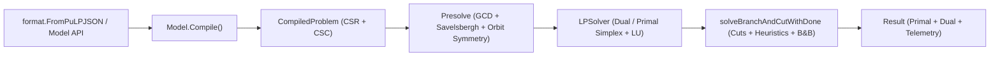

# `goblin` Architecture and Design Specification

The `goblin` solver separates algebraic model building, sparse matrix assembly, numerical search, and file-format I/O into five isolated layers. Each layer communicates through encapsulated data containers (`CompiledProblem`, `Result`, `LPResult`) so that concurrent workers can solve independent problem instances without shared mutable state, using either the default pure-Go engine (`BackendGo`) or the optional in-process C++ COIN-OR CBC/CLP backend (`BackendCBC`).

---

## 1. Architectural Layer Separation

| Layer | Source Files | Core Responsibility |
| :--- | :--- | :--- |
| **1. Modeling & Compilation** | [`model.go`](../model.go), [`expr.go`](../expr.go), [`compiled.go`](../compiled.go) | Collects variables, linear expressions, and constraints, validates variable ownership and finite coefficients, deduplicates terms, and compiles encapsulated `CSR` and `CSC` sparse matrices (`CompiledProblem`). |
| **2. Linear Algebra & LP Engine** | [`lu.go`](../lu.go), [`simplex.go`](../simplex.go), [`exact_polish.go`](../exact_polish.go), [`workspace.go`](../workspace.go), [`internal/simd/`](../internal/simd/) | Executes singleton-preordered sparse Markowitz `LU` factorization with `BTRANExact` Farkas verification and in-place mutated-$U$ Forrest-Tomlin updates, Revised Dual Simplex with `FTRANSparseHint`/`BTRANSparseHint`, anti-degeneracy cost perturbation, and bound flipping, exact `*big.Rat` basis polishing (`ExactBasisDuals`) and LP/MILP unboundedness certification (`ExtractUnboundedCertificate`), plus Two-Phase Primal Simplex over pooled `Workspace` buffers. |
| **3. MILP Branch-and-Cut & CBC Bridge** | [`presolve.go`](../presolve.go), [`cuts.go`](../cuts.go), [`heuristics.go`](../heuristics.go), [`bab.go`](../bab.go), [`vipr_trace.go`](../vipr_trace.go), [`vipr_json.go`](../vipr_json.go), [`certified.go`](../certified.go), [`solve.go`](../solve.go), [`cbc_cgo.go`](../cbc_cgo.go) | Runs LP and MILP presolve (`presolveLPWithDeadline`, `presolveWithDeadline`, `PresolveForVIPR`), multi-row cut aggregation and globally valid in-tree cut separation (`generateInTreeCutRound`), primal heuristics, dynamic orbital branching, opt-in `WithVIPRTrace` proof generation, fail-closed `WithCertified` / `VerifyVIPRTrace` verification (dead-code-eliminated when unreferenced), and single-threaded or parallel `WithWorkers` Branch-and-Cut in pure Go, or dispatches the compiled `CSC` matrix to COIN-OR CBC/CLP under `-tags cbc`. |
| **4. Combinatorial Assignment (`goblin/assign`)** | [`assign/assign.go`](../assign/assign.go), [`assign/solver.go`](../assign/solver.go), [`assign/certified.go`](../assign/certified.go), [`assign/workspace.go`](../assign/workspace.go), [`assign_alias.go`](../assign_alias.go) | Solves square and rectangular Linear Sum Assignment Problems (`LSAP`) via Jonker-Volgenant and Bijsterbosch-Volgenant dual reduction, post-ARR Volgenant sparse-core pricing (`runSparseCorePostARR`), 3-way partitioned Dijkstra shortest augmenting paths over pooled workspaces, and optional fail-closed `assign.WithCertified` verification. |
| **5. Serialization & Benchmarking** | [`format/pulp_json.go`](../format/pulp_json.go), [`format/pulp_json_fast.go`](../format/pulp_json_fast.go), [`format/mps.go`](../format/mps.go), [`bench/corpus.go`](../bench/corpus.go), [`bench/assign_corpus.go`](../bench/assign_corpus.go), [`bench/docgen.go`](../bench/docgen.go), [`cmd/goblin-optcheck/main.go`](../cmd/goblin-optcheck/main.go) | Streams `PuLP` JSON payloads directly into `Model` (`FromPuLPJSONBytes`) or into the intermediate AST, writes free-format MPS files, generates the 31-family synthetic MILP corpus (293 trials) and 22-family synthetic LSAP corpus (200 trials), synchronizes markdown tables from JSON telemetry, and audits hot-path disassembly diagnostics. |

---

## 2. Core Data Invariants

### Dual-Index Sparse Representation (`CompiledProblem`)
The function [`Model.Compile()`](../compiled.go) produces an immutable [`CompiledProblem`](../compiled.go) whose internal `CSR` and `CSC` slices are unexported so external callers cannot violate matrix or C++ ABI invariants, while read-only accessors (`NumVars`, `NumConstraints`, `NNZ`, `VarBounds`, `VarCategory`, `RowRHS`, `ForEachRowTerm`, `ForEachColTerm`) expose structural inspection:
- **Row-Major (`CSR`)**: `rowPtr` ($m+1$), `colIdx` ($\text{nnz}$), and `rowVal` ($\text{nnz}$), sorted by ascending column index within each row. Node bound propagation (`propagateBounds` and `propagateRow`), cutting-plane rounds (`generateCutRound`), and primal residual checks (`MaxViolation`) scan `CSR` slices sequentially.
- **Column-Major (`CSC`)**: `colPtr` ($n+1$), `rowIdx` ($\text{nnz}$), and `colVal` ($\text{nnz}$), sorted by ascending row index within each column, paired with 32-bit `colPtr32` and `rowIdx32` views validated before zero-copy C++ `loadProblem` calls. Simplex column pricing, basis matrix assembly (`factorizeBasis`), and `FTRAN` spike updates scan `CSC` slices sequentially.
- **Internal Objective Sense**: Every problem is normalized internally to minimize `objMin[j] = sense * objCoeffs[j]`. User-facing objectives and bounds convert back through `ObjectiveFromMin` and `EvaluateObjective`.

### Pooled Solver Workspaces (`Workspace`)
To reuse numerical buffers across solves and Branch-and-Bound node re-solves, [`AcquireWorkspace`](../workspace.go) and [`ReleaseWorkspace`](../workspace.go) manage a `sync.Pool` of pre-allocated [`Workspace`](../workspace.go) structs guarded against double release by an atomic `inPool` flag. Each `Workspace` encapsulates basis arrays (`basis`, `basicRow`, `status`, `rowBasicDeg`), working bounds and costs (`lb`, `ub`, `cost`, `workCost`), primal/dual iterate vectors (`x`, `xb`, `y`, `dj`, `dse`), tableau and sparse transformation buffers (`rho`, `rhoIdx`, `fCol`, `fColIdx`, `tau`, `tauIdx`, `tabRow`, `tabRowIdx`, `tabRowMark`, `tabRowChunks`, `tabRowChunkMark`, `flipCols`, `bfrtCands`), and the reusable [`LUFactorization`](../lu.go).

---

## 3. Detailed Documentation Guides

1. **[Modeling API and Serialization Formats](modeling-and-formats.md)**: Complete reference for `Model`, `Var`, `Expr`, `Constraint`, `CompiledProblem`, `PuLP` JSON, and MPS I/O.
2. **[Solver Internals and Mathematical Specification](solver-internals.md)**: Equations and algorithmic details for `LU` factorization, Dual and Primal Simplex, SIMD vector kernels, presolve, cuts, heuristics, and Branch-and-Cut.
3. **[Benchmark Methodology and Corpus Results](benchmarks.md)**: Reproducible benchmark protocol, hardware specs, MAD `G x I` model structure, and synchronized telemetry tables.
4. **[Formal Verification Architecture (Lean 4 Prove Lane)](formal-verification.md)**: Industry precedents, anti-translation-gap rules, fail-closed `WithCertified` / `assign.WithCertified` runtime verification, and the five-track Lean 4 verification suite (`23` Lean files, `1,188` authored theorems, `4,674` kernel-checked declarations, `162` axiom locks, `0` `sorry` or custom axioms) covering certificate checking (`assign`, `simplex.go`, `exact_polish.go`, `certified.go`, `vipr_trace.go`), soundness proofs (`cuts.go`, `presolve.go`, `bab.go`), and binary/SIMD equivalence across `14` compiled `arm64` ELF routines and `6` decoded `amd64` vector kernels.
